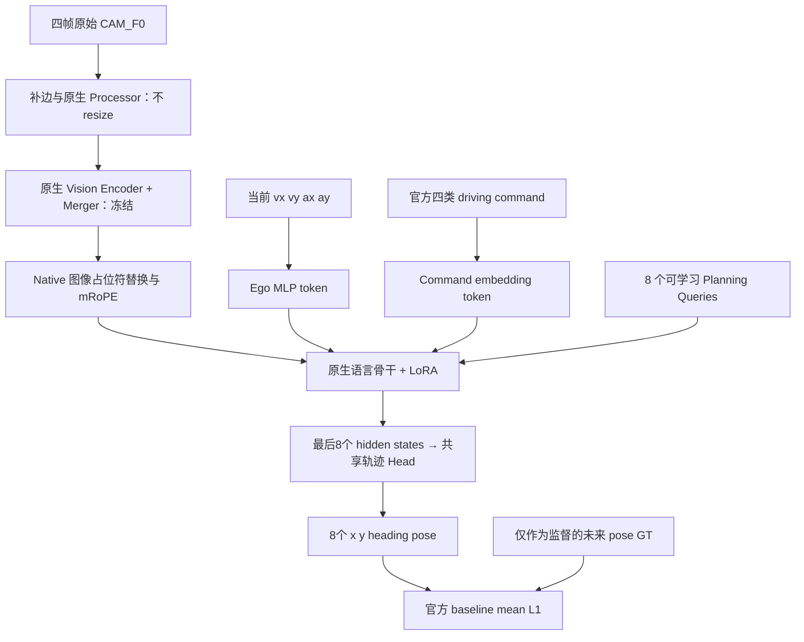

# NAVSIM Fast-only：原生 Qwen3.5 轨迹规划基线

使用 **Qwen3.5-0.8B 原生多模态骨干**，输入 NAVSIM/OpenScene 的四帧前视图像、当前 Ego 动态状态和官方导航命令，单次 forward 输出未来 **4 秒、8 个 `(x, y, heading)` pose**。

本分支新增 [Slow-Fast V1.1 P0 接口原型](docs/SLOWFAST_V11_P0.md)：真实 2B→0.8B 六层 KV、Planning Queries 可见性和联合梯度审计。它使用独立目录 `slowfast_v11/`；以下 Fast-only 验收记录仍对应原基线。异步调度、Future 检验和闭环收益尚未完成。

后续的[小规模适配与 KV 验证](docs/SLOWFAST_V11_VALIDATION.md)包含真实训练、同检查点对照和独立重载。本轮验收工程可训练性，尚未验证充分收敛，不用于判断架构优劣或性能上限；请区分独立训练路径对照与同检查点 KV 开关诊断。

[KV 快慢参考代码与训练配方审计](docs/KV_REFERENCE_TRAINING_AUDIT.md)核对了 OpenPI、DriveVLA-W0、Fast-in-Slow 和导航 AsyncVLA。直接 KV 拼接有公开代码先例；当前优先补足任务化训练和持续 Stage D，保留原架构。

[加强 Slow 与持续 live-KV 联合训练](docs/SLOWFAST_V11_JOINT.md)新增三路受控诊断：相同初始化和 TRAIN 目标，Slow 都接受自身监督，比较无 KV、断梯度 KV 与 Fast-loss→Slow 联合训练。入口仍是固定小样本实验，不能代替全量或异步闭环训练。

[256窗口扩数据实验](docs/SLOWFAST_V11_EXPANDED.md)固定4条TRAIN日志、2条新VAL日志，并单独保留原VAL4；采用预训练重新初始化、epoch采样和warmup/cosine日程，比较无KV与live-KV两组。该入口仍是有界mini诊断。

[固定检查点的KV内容诊断](docs/SLOWFAST_KV_CONTENT_DIAGNOSTIC.md)区分正确内容、外部槽位和缓存元数据：固定当前输入与位置，比较屏蔽外部列、V置零、固定参考及更强条件错配，并检查Slow有优势时Fast是否受益。只做离线诊断，不新增训练或下载。

[冻结Slow的可读性与空路径诊断](docs/SLOWFAST_KV_READABILITY.md)验证完整六层KV可被小型Reader读出轨迹，并区分metadata与数值实现路径。它包含两个读出器的真实训练、独立重载和原生SDPA数值核对。

[专用ActionExpert与完整Fast对照](docs/SLOWFAST_ACTION_EXPERT_CONTROL.md)固定Slow，每支新增4096个样本更新：145M全参数Expert学会来源依赖，但本次留出规划误差未赢过完整Fast＋LoRA；Fast仍未建立正确KV的稳定增量收益。两支均通过实际最后一步重放。这是小规模适配机制对照，不能作为论文复现或全量训练结论；[参考实现审计](docs/KV_EXPERT_REFERENCE_AUDIT.md)列明训练与结构差异。

[冻结Fast＋Reader残差融合](docs/SLOWFAST_READER_FUSION.md)保留原唯一轨迹Head，仅训练726K融合模块。新VAL正确来源ADE为0.782680m，原Fast关闭分支为0.952469m；固定来源训练对照也达到0.791077m，且第二条VAL日志的正确来源劣于固定/错配干预。因此融合改善了当前基线，但稳定的来源匹配增量仍未建立。两臂同初始化/顺序/16个新增epoch，原图在线检查、全VAL重载与最后一步恢复均精确通过。

后续KV机制研究的主要适配基线为 **Fast＋固定特征任务适配器**，R0随包保存，在线只运行Fast及726K融合模块；[加载与推理说明](docs/FIXED_ADAPTER_USAGE.md)。[三个配对种子与八条新日志验证](docs/SLOWFAST_ADAPTER_STUDY.md)中，真实来源相对该基线的平均ADE收益仅1.83mm，95%区间−2.09至+6.99mm，未达预先锁定的2cm门槛。原Fast/off保留为次要对照；当前结果不支持把额外任务适配收益记为快慢协作收益。原始Fast-only全量训练入口与本次固定Mini机制验证入口的范围分别记录在各自指南中。

[直接 KV＋完整 Fast 语言主干实验](docs/SLOWFAST_DIRECT_FULL.md)停止继续调整冻结 Reader 残差分支，真正扩大 TRAIN 为 512 窗口／12 个记录组，并另留 256 窗口／8 个新记录组。冻结 Slow 和 Fast 视觉塔，更新约 7.60 亿参数，比较同起点、同顺序、同预算的 Fast-only、正确直接 KV、固定直接 KV。三组均完成 1024×累积4 的真实全语言训练和完整冷重放。新 VAL ADE 为 Fast-only 0.416926m、当前 KV 0.393248m、固定 KV 0.416968m；训练臂配对改善 23.72mm，95% 日志区间 [1.48,48.14]mm，注册判据通过。但同一当前训练权重换成固定／错配 KV 推理为 0.392893／0.392488m，当前来源优势未建立。结果支持训练配方候选，不证明在线 Slow 必不可少；单种子、mini、开环、同步 fresh 条件的范围均保留。

**当前交付定位：已验证的单卡研究基线，可迁移；全量训练启动有条件。** Fast-only 基线的小规模开发与 Smoke 阶段已经结束，后续快慢机制研究按独立实验执行。本仓库没有完成全量 `navtrain` 训练，也尚未实现多卡 DDP 或官方 NAVSIM Agent/EPDMS 接口。

[冻结检查点的六层 KV 读取定位](docs/SLOWFAST_KV_READ_TRACE.md)保持 Slow 冻结，未新增训练或下载。768 次来源推理精确复现旧结果，1152 次单层干预完成；固定 Q 的换源差异穿过 gate／o_proj 并到达 Head。移动子集的读出相对差异在 Head 第一线性映射附近变小，但正确来源仍无 ADE 优势；这支持继续定位任务读出，不能把 Slow 自身轨迹分数作为必须先重训它的依据。

> **不能直接执行 `configs/navsim.yaml` 开始全量训练。** 当前 Schema 固定 mini cohort、清单路径和已验证训练预算，正式入口会主动拒绝在该 cohort 上训练。接入完整数据需要修改配置校验、数据准备和训练工程，**不需要修改 Backbone、8 个 Planning Queries 或轨迹 Head**。详见[全量训练迁移指南](docs/FULL_DATA_TRAINING.md)。

## 已验证到什么程度

以下是 **2026-11-02 在单张 NVIDIA H800 上记录的结果**，不是在读者环境或 GitHub Actions 上重新运行的成绩。

| 项目 | 结果 |
| --- | --- |
| 数据 | 3 段独立 log；TRAIN 12 / VAL 4 窗口；没有用于选择的 TEST |
| 输入 | 2Hz，四帧 CAM_F0：`[-1.5,-1.0,-0.5,0]s` |
| 图像 | 原图 1920×1080，仅补边到 1920×1088；不缩放、不重新压缩 |
| Native 布局 | 2,040 visual tokens/帧；完整序列长度 8,247 |
| 输出 | `[B,8,3]`，未来 `[0.5,1.0,…,4.0]s` 的局部后轴 SE(2) pose |
| 梯度 | Vision+Merger 冻结；LoRA、Ego、command、queries、head 梯度非零且有限 |
| 配置 smoke | MB2×累积8，有效 batch16；保留 8,000 步日程/240 步 warmup，只执行前4步 |
| 移动单样本过拟合 | 300步；ADE **0.00369m**，heading MAE **0.000673rad** |
| 实际恢复 | 恢复 update2→3，与不中断执行的参数、Adam 状态和 pose 差异均为0 |
| 独立进程重载 | 重新构造基座+checkpoint，两份模型的预测差异均为0 |
| 回归测试 | 历史记录 **402 passed**；包括真实 Processor 的未来隔离测试 |
| 显存 | MB2 训练峰值 allocated **39.23GiB**；MB1 深过拟合 **20.76GiB** |

原图 batch1 延迟各预热10次、测量100次：Model-only P95 **166ms**，Streaming E2E P95 **454ms**，Disk E2E P95 **490ms**。Disk 有 **3/100** 次超过500ms，P99约516ms，不能保证严格实时2Hz。该延迟不作为离线训练迁移的阻塞条件。

详细口径见[验证记录](docs/VALIDATION.md)和[结构化证据](evidence/smoke_summary.json)。小样本过拟合与通道敏感度不代表泛化能力、导航语义已学好或官方 PDMS/EPDMS 成绩。

## 代码如何工作



- Navigation 使用官方四维 one-hot 的原生类别索引，**没有连续 Target Point 分支**；不补零、不用未来轨迹伪造目标。
- Ego 使用当前官方 `ego_dynamic_state=[vx,vy,ax,ay]`，只用 TRAIN 统计量标准化。
- 坐标原点是当前后轴，x 前/y 左，采用 NAVSIM SE(2)，不使用 CARLA 的 y 翻转或 GNSS 修正。
- Vision+Merger 和语言基座冻结；语言 Attention/FFN 使用 LoRA，新增输入模块、queries、head 可训练。没有 Slow、CoC、Cross-Attention 或附加规划 Loss。
- Loss 对齐官方 MLP baseline：所有 batch/pose/x-y-heading 分量的平均绝对误差。位置单位 m、heading 单位 rad，因此 pose loss 不标作米；XY ADE/FDE 与 wrapped heading MAE 分开报告。

实现细节及文件映射见[代码逻辑](docs/ARCHITECTURE.md)。

## 目录

```text
fast_navsim/       当前 NAVSIM 数据、模型、训练、验证与 checkpoint
fast_only/         被复用的原生 Qwen/LoRA、预取、调度器等共享实现；保留旧 B2D 协议
configs/navsim*.yaml
tools/            NAVSIM 小样本准备/预检/独立重载；另含历史 B2D 辅助工具
tests_navsim/     NAVSIM 协议、模型、配置、隔离与恢复测试
tests/            共享/历史 B2D 回归；NAVSIM tiny-model 测试也复用其中的 fixture
docs/             架构、验收口径和目标集群接入说明
evidence/         不含原始数据/权重/本机路径的精选历史验证记录
```

`fast_only/` 是实际运行依赖，不能只复制 `fast_navsim/`。NAVSIM 与 B2D 的命令、坐标、采样频率和输出维度不同，不要交叉套用。

## 环境和权重

已执行的环境记录在 [environment.json](evidence/environment.json)。`requirements.txt` 和 `requirements-hopper.txt` 是安装清单，[已安装版本清单](evidence/observed-installed-versions.txt)是源服务器有效环境的记录，**不是经过干净环境验证的通用 lockfile**。

在目标机器创建独立 Python 3.12 环境，选择与驱动兼容的 PyTorch/CUDA。原验证栈为 torch2.8.0+cu128、transformers5.10.2、PEFT0.18.1、FLA0.5.1、causal-conv1d1.6.1、TileLang0.1.15、Triton3.6.0。例如原 CUDA12.8 栈：

```bash
python3.12 -m venv .venv
source .venv/bin/activate
python -m pip install torch==2.8.0 --index-url https://download.pytorch.org/whl/cu128
python -m pip install -r requirements.txt
```

CUDA 扩展必须匹配目标 torch/CUDA/toolkit。原 Hopper+FLA+Triton 栈触发过上游反向核保护，验证时使用 TileLang 后端；不要通过删除上游保护来跑训练。原有兼容环境可参考：

```bash
python -m pip install flash-linear-attention==0.5.1
python -m pip install causal-conv1d==1.6.1 --no-build-isolation
# 在已经匹配的 torch/CUDA/FLA 环境中补充 Hopper 依赖：
python -m pip install --no-deps -r requirements-hopper.txt
export CUDA_HOME=/path/to/your/cuda-toolkit
export PATH="$CUDA_HOME/bin:$PATH"
export FLA_TILELANG=1
export CUBLAS_WORKSPACE_CONFIG=:4096:8
```

这是一份已测栈的重建参考，不保证其它 GPU/CUDA 组合直接兼容。`CUBLAS_WORKSPACE_CONFIG` 要在 Python/CUDA 初始化前设置。

基座固定为 `Qwen/Qwen3.5-0.8B` revision `2fc06364715b967f1860aea9cf38778875588b17`。仓库不分发权重，放在 `models/Qwen3.5-0.8B`；标识和资产 SHA 见 [model_identity.json](evidence/model_identity.json)、[model_asset_sha256.json](evidence/model_asset_sha256.json)。加载启用 `local_files_only=True`。

## 小规模验证入口

以下供**目标服务器**复现协议和环境，原服务器不再追加 Smoke。仓库没有数据、基座权重或历史 `outputs/`，必须先按上述固定版本准备权重。

```bash
# 有上限的公开 mini 数据获取；默认预算1GB，不下载整套 mini。
python -m tools.prepare_navsim_smoke --config configs/navsim_preflight.yaml --acquire

# 保留正式模型/原图/batch/8000步日程，实际只运行4步，再做独立300步诊断。
python -m tools.run_navsim_preflight

# 另一个 Python 进程，从基座与 checkpoint 重建并比较预测。
python -m tools.verify_navsim_reload

# 需要依赖与本地 Processor/权重资产；历史402项是此前执行的证据。
PYTEST_DISABLE_PLUGIN_AUTOLOAD=1 python -m pytest tests tests_navsim -q
```

已有数据时去掉 `--acquire`，只从保留文件构建。已有训练输出时入口拒绝覆盖；不要在训练/续训过程中重建清单、统计量或来源审计。源机器的绝对路径和旧 checkpoint 不会自动重定位。

## 转移后全量训练

1. 用官方 `navtrain` Scene Filter 准备实际训练场景，保存 scene token/log 分组、缺失文件与 timestamp 拒绝统计；从训练来源建立独立 VAL，不用 `navtest`/`navhard_two_stage` 选型。
2. 生成完整 Manifest 和 **完整 TRAIN-only** Stats，接入正式配置 Schema/路径与安全检查。当前 mini 构建器不是完整 `navtrain` pipeline。
3. 按实际 TRAIN 数量确定 epoch、无放回 shuffle 采样与完整 LR 日程，保留确定性恢复。8,000步只是参考预算，不应在训练不足时才发现 cosine 已归零。
4. 单卡先确认目标 GPU 原图前反向/显存/吞吐；多卡需接入 DDP、rank-aware sampler/RNG、全局 batch、指标聚合和 rank0 checkpoint。**不能直接给当前入口套 `torchrun`。**
5. 正式训练从预训练 Qwen 初始化新的 LoRA/queries/head；不以单样本过拟合 checkpoint 初始化。按 VAL ADE 选择模型，报告 FDE、各时域 L2 和 heading MAE；训练后再接官方 Agent/EPDMS。

具体需要改哪些文件、如何处理路径/恢复与数据吞吐，以及集群首次短训练的验收清单，见 **[FULL_DATA_TRAINING.md](docs/FULL_DATA_TRAINING.md)**。

官方参考：[NAVSIM 输入/输出](https://github.com/autonomousvision/navsim/blob/0a380a9063d7162ec93d0f51e9990ebac585f720/docs/agents.md)、[数据划分](https://github.com/autonomousvision/navsim/blob/0a380a9063d7162ec93d0f51e9990ebac585f720/docs/splits.md)、[官方 baseline](https://github.com/autonomousvision/navsim/blob/0a380a9063d7162ec93d0f51e9990ebac585f720/navsim/agents/ego_status_mlp_agent.py)。数据、模型和第三方依赖的获取与使用按各自上游说明执行。
