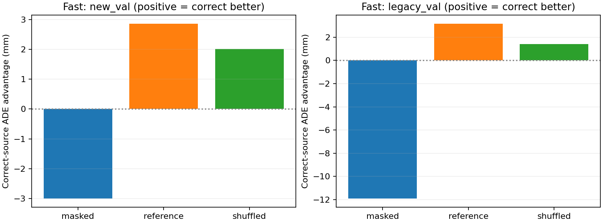
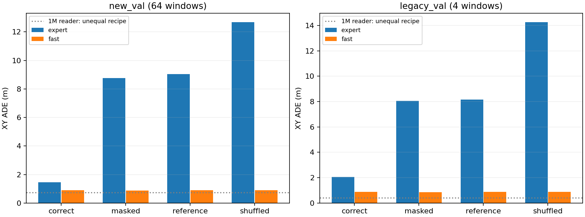
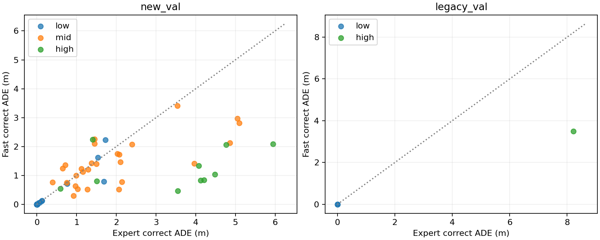
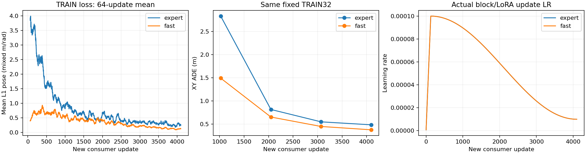

# 冻结 Slow：专用 ActionExpert 与完整 Fast 控制

两条预声明消费者训练及4095→4096实际更新重放均完成。新VAL上Expert正确KV ADE为1.455m，完整Fast＋LoRA为0.888m；Expert学到来源依赖，Fast仍没有稳定的正确KV增量收益。本报告区分“是否消费来源”与“绝对规划质量”，不把来源敏感度当作性能上限或论文复现。

## 固定方法与比较边界

固定 expanded joint step800 的 Slow KV、同一 TRAIN256（四日志）及归一化统计；新 VAL64（两日志）和原 VAL4（一日志）分开报告。它们已被之前实验观察，是诊断 VAL，不能重新称为独立 TEST。没有下载数据，也没有更新 Slow。

每个消费者均新增4096步、micro-batch1，即16个完整 TRAIN epoch；seed42，相同无放回 epoch shuffle 顺序。训练只使用正确源 KV。Loss 为8×3 SE(2) mean L1 pose，混合 m/rad；ADE/FDE 只衡量 XY。AdamW block/LoRA LR1e-4、条件模块/Head LR5e-4，WD0.01、clip1；128步预热后 cosine 至10%。固定 TRAIN32 在1024/2048/3072/4096步观察；最终固定预算后才评估 VAL，没有按 VAL 调参、早停或延长。

Expert 是新随机初始化的145,145,859参数、24层全参数 dense decoder：残差宽512、SwiGLU1536、8 Query heads/2 KV heads/head dim256；每四层依次读取 Slow4/8/12/16/20/24 的原始 K/V，因此每次共24次源 Attention。源 K/V 不做适配投影或重新 norm，K 使用原生 Qwen3.5 partial mRoPE 一次；当前 Ego、command、metadata 和八个 planning queries 构成11个因果自身 token。源全部屏蔽时仍保留自身 Attention 和相同有效 metadata。

完整 Fast 消费者保留0.8B模型、当前四张原图的视觉输入、18层 GDN 和六层融合，更新语言 LoRA及现有新增模块。它从已经训练的 joint Fast 起步，已有1312次曝光；Expert 没有这份任务初始化。两者同新增样本数，不同初始状态、参数数、输入路径、源读取次数和 FLOPs；不能解释为只有“全部参数 vs LoRA”这一因素的消融。

Fast 缓存的仅为已冻结视觉塔/merger 对原始图像的原生输出。图像和 Processor 不变；语言主干每次完整重算。两个预声明实例（一个 TRAIN、一个新 VAL）核对缓存前后预测最大差0，并有 CPU 单测；这不等于逐一验证全部324个窗口。运行耗时及峰值包含准备、模型/缓存加载、Fast 视觉特征生成和评估成本，不是部署延迟或推理频率。

主要位置协议保持现有 Fast 的4096 reserved offset：Expert 第一个 sensor 位置为源 Slow18-token suffix 首位置+4096，随后11个位置递增。它不是论文连续位置协议。此模型是QwenDrive启发的直接KV/native几何/全dense消费者，不是完整论文配方：state/nav/metadata只由三个输入token提供，没有每block的AdaLN条件注入，没有noisy waypoint或flow-time Fourier编码，也没有50点flow matching。保留的是8×3回归、L1、11个因果token和reserved4096位置。这些差异可能影响轨迹预测质量，在TRAIN256下不能排除，故不声称论文复现或论文正控失效。

终点评估正确来源、全部外部列 masked、固定最小 TRAIN 来源、原 split/cohort-local shuffled 来源。保留当前输入、目标位置布局及 metadata，只替换源内容。四种条件中只有 correct 被本轮训练；其余是无效/分布外推理反事实，并非单独训练的无 KV 基线。正确来源优于反事实说明来源依赖，不能独自证明绝对规划良好或新视觉推理；缓存本身也包含 Ego、导航和旧 Fast 数值候选。

## 固定终点结果

下表由保存预测以 NumPy float64 重算；原始 float32汇总保留在每臂 result.json。新/原 VAL 分开，单位为米。

| Cohort | 消费者 | correct ADE | masked ADE | reference ADE | shuffled ADE |
| --- | --- | ---: | ---: | ---: | ---: |
| new_val | expert | 1.454802 | 8.753338 | 9.045369 | 12.676102 |
| new_val | fast | 0.888007 | 0.885010 | 0.890863 | 0.890014 |
| legacy_val | expert | 2.054985 | 8.047524 | 8.162652 | 14.253900 |
| legacy_val | fast | 0.875769 | 0.863878 | 0.878925 | 0.877186 |

Expert 正确来源明显优于其反事实条件，说明它在这份配方中学到了来源依赖；但其新 VAL正确来源 ADE 为 1.454802m，原 VAL为 2.054985m，不能描述为绝对规划已良好或已经建立上限。它在这个适配配方中没有赢过Fast，不等于完整论文正控失败，也不证明小LoRA通常优于全参数Expert。冷启动145M模型在固定16 epoch配方下的表现，不是否定专用 Expert 架构的证据。

**Fast的正确内容增益仍弱。** 新VAL中 correct 比 masked 的ADE反而高 2.996645mm，只在22/64窗口更好；相对shuffled的平均改善仅 2.007374mm。原VAL correct也比masked高 11.891099mm。这是当前固定配方检查点的XY结果，不是充分训练的能力上限或KV信息不存在的证据；也不能把错误源/屏蔽源的退化直接当作独立训练的无KV架构成绩。

正确来源的FDE与航向误差一并保留，避免把ADE当作所有指标：

| Cohort | 消费者 | ADE(m) | FDE(m) | heading MAE(rad) |
| --- | --- | ---: | ---: | ---: |
| new_val | expert | 1.454802 | 2.881140 | 0.064766 |
| new_val | fast | 0.888007 | 2.078766 | 0.034502 |
| legacy_val | expert | 2.054985 | 3.558492 | 0.004167 |
| legacy_val | fast | 0.875769 | 1.973944 | 0.006359 |

Fast 相对 Expert 的新 VAL correct 配对平均 ADE 改善为 0.566795m，中位数为 0.001943m；46/64窗口改善、18退化。正负均保留。速度分层、每窗口 correct 对 masked/reference/shuffled 的配对差值和两臂比较见 [stratified_summary.json](../evidence/slowfast_expert_control/stratified_summary.json) 与 [window_metrics.json](../evidence/slowfast_expert_control/window_metrics.json)。

| 日志 | 窗口数 | Expert correct ADE | Fast correct ADE |
| --- | ---: | ---: | ---: |
| `2021.05.12.23.36.44_veh-35_02035_02387` | 32 | 1.944488 | 1.078513 |
| `2021.10.11.02.57.41_veh-50_00352_00535` | 32 | 0.965115 | 0.697501 |
| `2021.06.28.16.57.59_veh-26_00016_00484` | 4 | 2.054985 | 0.875769 |

此前1,002,553参数 KV Reader 的新 VAL ADE 为 0.737662m；它训练1024×batch8，即32 epoch，另有TRAIN-RMS缩放、学习型K/V投影、显式位置特征和group-count prior。Expert直接消费原生K/V并使用native RoPE，二者不只是参数量不同。小Reader列为不等预算/不同结构参考，不能由它和145M Expert的差异推断参数越大越差。最终特征 MLP与原 Slow Head 的对照见[可读性报告](SLOWFAST_KV_READABILITY.md)。

## 优化、冻结源与资源记录

| 消费者 | 可训练/总参数 | 总耗时(s，含准备) | peak allocated GiB | 梯度norm中位数（clip前） | 被clip比例 |
| --- | ---: | ---: | ---: | ---: | ---: |
| expert | 145,145,859/145,145,859 | 758.08 | 36.884 | 16.511292 | 79.13% |
| fast | 7,197,699/860,183,619 | 1609.64 | 56.093 | 15.818938 | 76.25% |

所有4096步 loss/梯度norm/LR记录均有限；Expert在1/1024/2048/3072/4096步对全部24块记录有限、非零梯度。这只证明这些检查点各块存在梯度，不证明每个参数每步都获得有效语义学习。源 KV/位置/group/mask版本未变；两臂源模型、数据/统计、feature manifest和全部4096个目标顺序身份逐一核对相同，详见[verification.json](../evidence/slowfast_expert_control/verification.json)。

| 新增更新步 | 固定 TRAIN32 Expert ADE | 固定 TRAIN32 Fast ADE |
| --- | ---: | ---: |
| 1024 | 2.834205 | 1.493472 |
| 2048 | 0.816894 | 0.653767 |
| 3072 | 0.549804 | 0.449650 |
| 4096 | 0.485502 | 0.377577 |

曲线不是完整 TRAIN256 终点汇总，也不证明已收敛；4096步预算没有依据曲线或 VAL 结果再延长。

## 恢复、代码身份与科学边界

两臂均从4095步前的参数、AdamW、scheduler、RNG恢复，执行第4096步后比较模型、优化器、scheduler、RNG和保存预测。全部精确差0；它是同H800/runtime单步训练重放，非跨GPU保证，也不是完整VAL逐位重载。Expert重放包含280个模型张量、840个AdamW张量；Fast为209个模型/627个AdamW张量。

第一次Expert重放在构造/更新前因checkpoint tuple与JSON list表示不一致而拒绝；随后只修正读取比较的规范化并重新重放，没有重训或更改训练。失败日志SHA及成功证据均保留在[replay_history.json](../evidence/slowfast_expert_control/replay_history.json)、[expert_replay.json](../evidence/slowfast_expert_control/expert_replay.json)、[fast_replay.json](../evidence/slowfast_expert_control/fast_replay.json)。

Expert历史trainer对应`d82fac8`，Fast对应`fc4cb32`；记录SHA与Git blob核对一致。两版差异仅是未用dummy final缓存初始化、直接保存Fast ego/command重放包和TRAIN曲线输出，不涉及forward、loss或optimizer；保留[代码身份与diff](../evidence/slowfast_expert_control/code_identity.json)。新鲜回归记录为 652 passed，时间`2026-11-07T06:21:35.238854+00:00`，XML SHA256 `367597628be9a523b91f57be9f7f1fddc99863710c948df8cd3ca7601c59697f`；它不是此前readability的测试记录，也不能自动覆盖其后修改。

当前入口固定TRAIN256及8255-token缓存形状，GPU全量缓存只适合本批小样本。迁移到完整navtrain需核对官方Scene Filter、重新计算TRAIN统计量，并实现流式数据/KV读取、DDP采样恢复和按真实epoch设置LR日程，再在目标GPU测试。当前入口不能只替换manifest就启动全量训练；已有[全量迁移指南](FULL_DATA_TRAINING.md)仍适用。

本报告只覆盖有界诊断数据、一个seed、两个新VAL日志。来源敏感度可能依赖缓存里的运动/导航/旧反馈信息，未隔离视觉增量，也不构成在线异步或闭环成绩。没有上传GitHub成功的声明。权重、33GB源缓存、图像和replay输入不提交；portable JSON、曲线、预测和hash索引见[evidence目录](../evidence/slowfast_expert_control/SHA256.json)。
