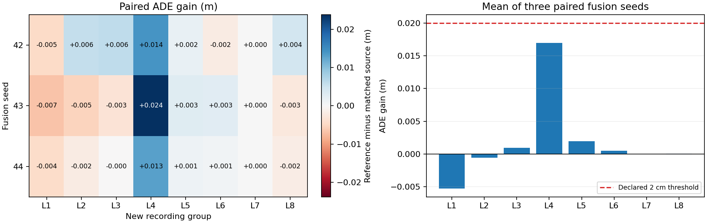
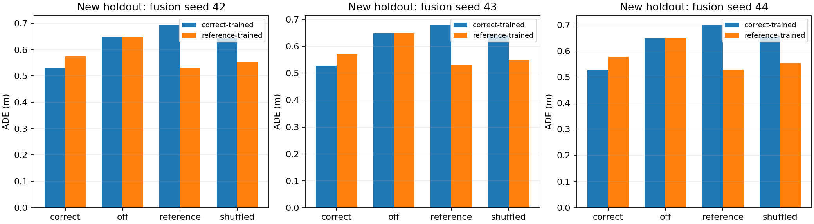
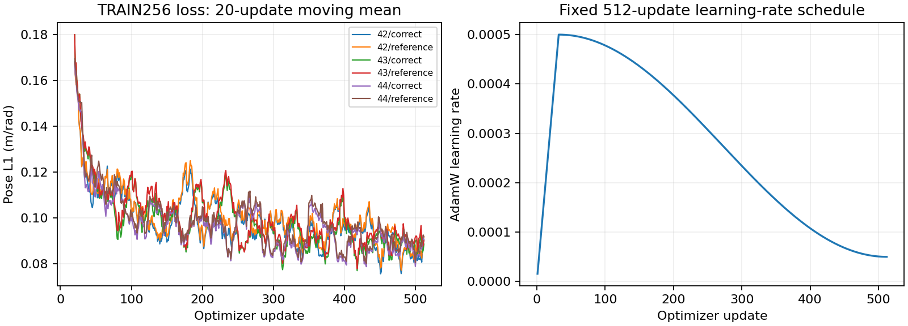
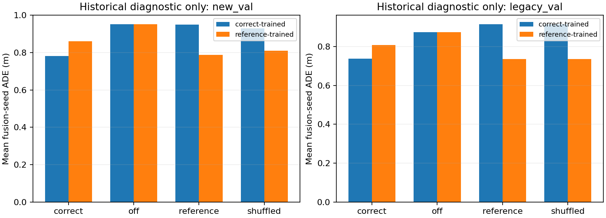

# 固定特征 Fast 适配器与新日志配对实验

匹配来源适配器**未达到预先声明的主要判据**：平均 ADE 收益为 `+0.001828 m`，种子与日志配对 bootstrap 的 95% 百分位区间为 `[-0.002089, +0.006986] m`。正收益定义为 reference 训练/reference 评估的 ADE 减去 correct 训练/correct 评估的 ADE。判据在读取新 holdout 指标前锁定：平均收益至少 `0.02 m`，**且**区间下界大于零。模型、阈值、训练日程和评估队列均未根据本次结果选择或调整。

Reader 条件分支的实用增量判据：**FAIL**。实际平均收益为 `+1.83 mm`，95% 区间为 `[-2.09, +6.99] mm`；区间跨越零；区间上界也低于预设的 20 mm 实用阈值。三个种子平均的 correct 训练/correct 评估 ADE 为 `0.527917 m`，reference 训练/reference 评估为 `0.529746 m`；原始 Fast/off 为 `0.648348 m`。固定 reference 基线已吸收大部分相对原始 Fast 的改善，本次证据未达到逐窗口 Reader 条件分支相对该基线所要求的额外收益。此主要比较本身不单独识别视觉信息或来源匹配语义的作用。

主基线是导出的固定来源 Fast+task-adapter，保留残差结构并只在原始 Fast 上在线计算；原始 Fast/off 为次要比较。[固定适配器使用说明](FIXED_ADAPTER_USAGE.md) 给出带哈希认证的加载与推理方法。读取本轮终点结果后，没有延长训练、追加日志/窗口或挑选种子。

## 主要配对证据

先在每个 recording group 内对窗口取均值，再等权平均八个组，最后等权平均三个融合训练种子。区间使用 20,000 次配对重采样：分别独立重采样三个种子索引和八个日志索引，对每次得到的笛卡尔子矩阵取均值，再取 2.5/97.5 百分位数（`analysis_seed=20261107`）。相邻窗口不作为独立重采样单位。跨种子平均后，日志收益中位数为 `+0.000295 m`，正收益日志数为 `6/8`。下表保留全部 3×8 配对效应，单位为米。

| Seed | L1 | L2 | L3 | L4 | L5 | L6 | L7 | L8 | Mean | Median | Positive logs |
| --- | ---: | ---: | ---: | ---: | ---: | ---: | ---: | ---: | ---: | ---: | ---: |
| 42 | -0.004572 | +0.005649 | +0.006097 | +0.014110 | +0.001801 | -0.002020 | +0.000006 | +0.004411 | +0.003185 | +0.003106 | 6/8 |
| 43 | -0.006784 | -0.005227 | -0.003197 | +0.023789 | +0.002886 | +0.002782 | +0.000005 | -0.002562 | +0.001462 | -0.001279 | 4/8 |
| 44 | -0.004457 | -0.002024 | -0.000094 | +0.012995 | +0.001122 | +0.000845 | +0.000005 | -0.001688 | +0.000838 | -0.000045 | 4/8 |

- L1: `2021.06.03.12.02.06_veh-35_00233_00609`
- L2: `2021.06.03.13.55.17_veh-35_00073_00426`
- L3: `2021.06.08.14.35.24_veh-26_02555_03004`
- L4: `2021.06.09.12.39.51_veh-26_05620_06003`
- L5: `2021.06.09.17.23.18_veh-38_02526_03027`
- L6: `2021.06.14.16.48.02_veh-12_04057_04438`
- L7: `2021.06.14.17.26.26_veh-38_04544_04920`
- L8: `2021.06.14.18.42.45_veh-12_03445_03902`

## 四种来源条件：次要分析

下表报告完整 256 窗口新 holdout 上的 ADE。每个日志均有 32 个窗口，因此此处总体均值也等于日志等权均值。六个训练端点均评估 correct、off、reference、shuffled 四种条件。[分层汇总](../evidence/slowfast_adapter_study/stratified_summary.json) 保留每个种子、每个日志和每个速度区间的 ADE、FDE、朝向及各预测时刻指标，以及 correct 训练臂的来源干预收益。速度区间为 low <1 m/s、mid 1–<10 m/s、high ≥10 m/s；这些切片仅作描述，不替代预先锁定的主要分析。

| Fusion seed | Training source | Correct | Off | Reference | Shuffled |
| --- | --- | ---: | ---: | ---: | ---: |
| 42 | correct | 0.528309 | 0.648348 | 0.694816 | 0.644425 |
| 42 | reference | 0.573886 | 0.648348 | 0.531494 | 0.552267 |
| 43 | correct | 0.528687 | 0.648348 | 0.680726 | 0.640414 |
| 43 | reference | 0.571526 | 0.648348 | 0.530148 | 0.550063 |
| 44 | correct | 0.526756 | 0.648348 | 0.700020 | 0.651487 |
| 44 | reference | 0.577585 | 0.648348 | 0.527594 | 0.551919 |

## 数据、冻结模型与配对预算

本实验是基于固定 OpenScene mini 版本的 NAVSIM-mini 诊断。新队列含八个此前未见的 recording group，每组固定取早期 32 个窗口。选择规则为：按名称排序符合条件的相机分片首日志，排除所有此前见过的 recording group（去除末尾数字分段范围后判断身份），取前八组及各组最早的 32 个有效 stride-five 锚点。全部 12 帧历史、当前及未来位姿均须有限且满足结构有效性；未来运动误差、图像是否存在及模型输出不参与选择。计划与 token 列表在相机访问前冻结。错误来源按排序后的八个日志偏移四位（模八），匹配同一按时间排序的窗口序号，形成跨 recording group 的双射；报告程序也独立重算并核对此映射。图像保留原始 1920×1080 JPEG，模型只输入 2 Hz 的四帧历史/当前图像，没有未来输入或重压缩。

初始 280,000,000 字节元数据前缀只得到七个合格的新 recording group。保留该失败记录后，操作性修订 1 使用原先 40,000,000 字节预留，将同一私有前缀扩展到 320,000,000 字节，并将新增元数据响应体额度提高到 200,000,000 字节。此修订发生在相机访问及模型评估前；八组规则、八个各 225,000,000 字节的相机额度、2,000,000,000 字节新增总上限、训练和分析规则保持固定，没有降为七组。实际新增响应体为 `1,694,753,510` 字节，其中元数据 `200,000,000`、相机 `1,494,753,510`；继承此前响应体 `1,708,332,171` 字节，累计 `3,403,085,681` 字节。计数包含尝试与重试。证据记录前缀、成员及原始图像的来源与哈希，不宣称已认证完整归档。

六次融合训练复用同一已认证的历史 TRAIN256 特征与归一化统计，冻结 Fast、Slow、Reader 和原始任务 head。Fast SHA256 为 `02c3964a225efd79e1c06644cbf49228a38a612021f211258e8476e6606882b1`；Reader 为 `f32855f1698752ca4c315665f0d554dc3cb646948a8dd00cd9d5b7cfca1e9bf7`；冻结 joint Slow 来源为 `448571f4d543913a4d93471781a1ecf4aa392078f2aa2dafa3816be43f9f0ae9`。新 Slow 的反馈来自保存的 Fast512 producer，不使用最新 Fast 或真值反馈。256 个新目标的来源布局全部一致，reference 特征恒定。种子 42/43/44 各自训练 correct 与 reference 两臂，同一种子内使用相同初始化与 4096 次有序抽样：512 次更新 × batch 8，即每个 TRAIN 窗口出现 16 次；AdamW 学习率 5e-4、weight decay .01、梯度裁剪 1、32 步 warmup、cosine 降至初始学习率的 .1。没有新增 backbone/Reader 更新、early stopping 或重复调参。

特征提取保留了一次真实失败与重试：第一次已完成全部 256 个窗口的冻结推理并保存五个完整输出，但在最后组装回执、读取 `len(audit['sources'])` 时，逐图像 audit 变量遮蔽了来源审计对象，导致回执生成失败。修复仅重命名两个变量（首次代码 `3edf0b1`，修复 `b1123a2`），未改变权重、数据或分析规则。随后重新执行同一冻结推理，并将第一次保留的特征 bank 张量、元数据及原生输入包与重试结果逐项精确比较；[提取重试回执](../evidence/slowfast_adapter_study/extraction_retry.json) 保留失败原因、代码版本、原始文件哈希和比较结果，不复制原始 PT。新 holdout 指标在这次修复与重试前尚未计算，也未用于决定重试。

## 固定适配器部署与复核

导出的 reference 基线包含融合权重及与认证 Fast checkpoint 绑定的常量 `R0[1,8,768]`。在线路径仍使用当前 Fast 图像、Ego 状态及导航输入，经原始 Fast、残差适配器及原始 head 输出；跳过逐窗口 Slow/Reader 推理及其视觉路径，也无需实时来源 KV。常量保留历史 Slow/Reader 先验，相应历史训练成本仍须计入。实际条件分支的 KV 同时包含视觉、Ego、导航和旧计划信息，因此本比较未单独隔离视觉增量。原始 Fast/off 是次要比较。实际冷启动 Fast-only 推理从原始图像重新处理输入，对每个融合种子检查相同的一个历史 TRAIN 样本和一个新 holdout 样本；全程未实例化 Slow 或 Reader，且与 reference 来源推理逐值完全一致。

六个融合训练均完成实际最后一步优化器更新重放，并完整重载各自 1024 个 holdout 来源条件的预测。种子 42 精确复现此前融合权重和全部 68 个历史验证窗口的预测。CPU 重算指标的最大绝对差为 `3.84717039e-07`，上限为 1e-5。回归测试 `745` 项通过，错误、失败和跳过均为零。历史训练代码通过 Git 版本 `22ced6a` 的 blob 认证；当前提取、评估、验证及报告代码另存哈希。便携证据仅包含 JSON/JSONL、图表及哈希，不复制权重或原始图像。

便携 `result.json` 保留评估完成时的历史标记 `verified:false`；最终独立复核状态以[报告验证记录](../evidence/slowfast_adapter_study/verification.json) 的 `passed:true` 及其中三类证明为准。

## 历史诊断与推断范围

此前的 `new_val`（64 窗口、两个日志）与 `legacy_val`（四窗口、一个日志）单列于[历史诊断汇总](../evidence/slowfast_adapter_study/stratified_summary.json) 和独立预测文件中。它们用于历史诊断和种子 42 身份复核，不进入本次新队列的主要效应矩阵或区间。

本区间条件于这些固定的 Fast、Slow、Reader 模型，三个种子仅代表融合模块训练随机性，不覆盖 provider、backbone 或 Reader 训练种子的不确定性。mini 中八段日志的早期片段是受传输预算约束的小型便利样本，相邻窗口重叠及同一 recording group 内相关性仍然存在；日志间异质性完整保留在配对矩阵中。本实验不构成整段 episode 表现、官方 NAVSIM navtrain/navtest 分数、异步传递行为或闭环驾驶收益的证据。主要判据结果对应这一次固定队列，不据此扩展队列或重新调参。

随文提供便携[主要统计](../evidence/slowfast_adapter_study/primary_analysis.json)、[验证记录](../evidence/slowfast_adapter_study/verification.json)、[源代码哈希](../evidence/slowfast_adapter_study/source_hashes.json)、[证据文件哈希](../evidence/slowfast_adapter_study/SHA256.json)、原始预测、训练 JSONL 轨迹、数据来源及四张图表。
