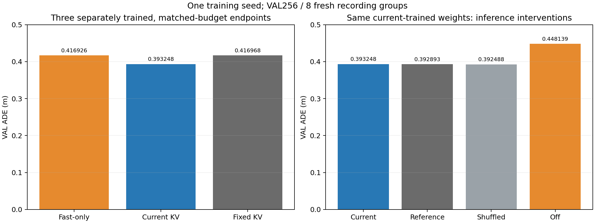
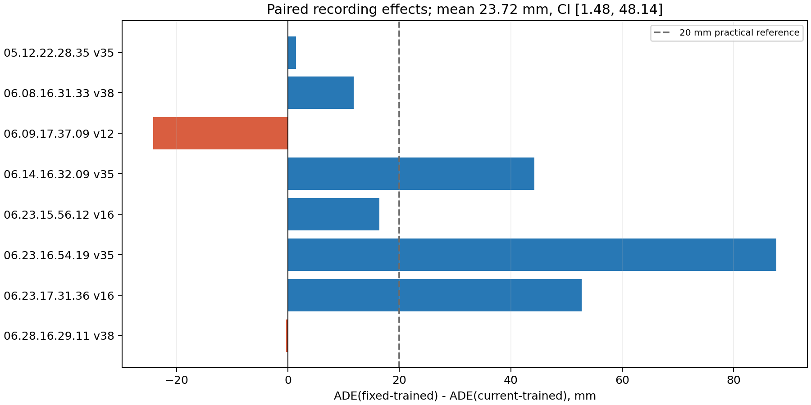
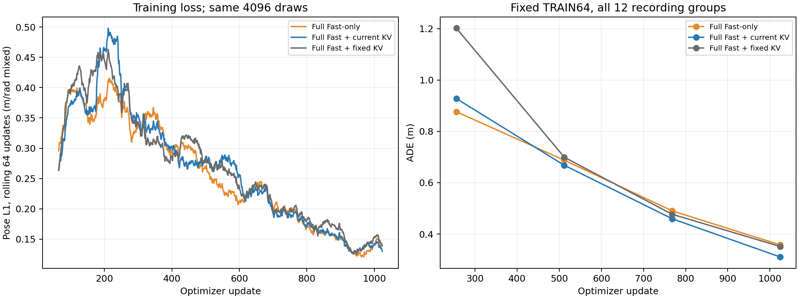
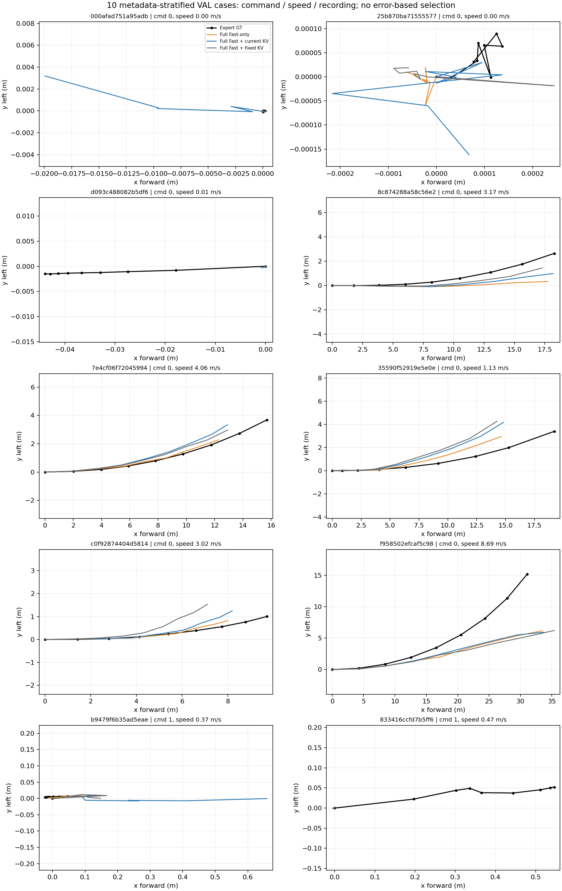

# 直接 KV 与完整 Fast 语言主干：扩大 TRAIN 的配对实验

本轮关闭“冻结 Reader＋Head 前残差融合”的继续调参，执行原直接 KV 主线。冻结 Slow、Fast 视觉塔及 merger；更新完整 Fast 语言主干的基础权重、已有 LoRA、输入编码、Planning Queries 和唯一轨迹 Head。没有增加 Reader、Expert、投影架构、异步刷新或动作匹配门控。

本轮已完成三组全语言训练、实际磁盘恢复重放、独立新 VAL 推理与来源干预。**注册训练臂终点判据通过；推理时当前场景 Slow KV 的必要性仍未建立。** 正确 KV 训练得到更好的权重，但该权重换成固定或错配 KV 推理没有出现正确来源优势。

## 完成结果与结论边界

三组均真正使用 TRAIN512／12 个记录组，完成 1024 次更新、4096 次窗口曝光和 8 个 epoch。新 VAL 为 256 窗口／8 个此前未使用的记录组。全部训练结束并完成实际最后一步重放后，才开始读取新 VAL 指标。

| 独立训练臂 | 新 VAL ADE（m） | FDE（m） | Heading MAE（rad） | 终点 TRAIN64 ADE（m） |
|---|---:|---:|---:|---:|
| Fast-only：完整语言训练 | 0.416926 | 1.016063 | 0.023671 | 0.358153 |
| 直接当前 KV：完整语言训练 | 0.393248 | 0.983888 | 0.021287 | 0.311008 |
| 直接固定 KV：完整语言训练 | 0.416968 | 1.030610 | 0.024761 | 0.351889 |

注册主比较为“固定来源训练／固定来源推理”减去“当前来源训练／当前来源推理”：平均 ADE 改善 **23.7204 mm**，95% recording-group 配对 bootstrap 区间 **[1.4757, 48.1399] mm**，平均相对改善约 5.69%。预先声明的“平均至少 20mm，且区间下界大于零”判据 **PASS**。这不表示区间下界也超过了 20mm。相对完整语言适配的 Fast-only，平均改善 23.6786 mm，区间 [3.7401, 46.8284] mm。

该终点比较支持这次**训练条件／配方**在共同起点和预算下得到更好的权重。推理端的内容干预给出了进一步的限制：

| 同一“当前 KV 训练”检查点，仅改变推理来源 | ADE（m） | FDE（m） |
|---|---:|---:|
| 当前正确来源 | 0.393248 | 0.983888 |
| 固定 TRAIN 来源 | 0.392893 | 0.982862 |
| 其他 VAL 日志错配来源 | 0.392488 | 0.982953 |
| 关闭 KV／No-cache 路径 | 0.448139 | 0.997372 |

固定或错配来源的平均 ADE 与正确来源接近，点估计还略低；探索性区间均跨零，**不能宣布错误来源更优**。正确来源相对固定来源的 ADE 收益为 −0.3541mm，区间 [−1.0286,+0.3156]mm；相对错配为 −0.7597mm，区间 [−1.5372,+0.2597]mm。这不是预先设定的非劣性检验，也不能证明每个窗口完全等效。

换源确实影响输出：固定／错配后 XY 预测点平均变化 5.468／5.737mm，最大变化 83.08／88.50mm；变化的逐点中位数仅约 0.019／0.016mm。内容敏感性存在，但未转化为当前来源匹配的准确率优势。关闭 KV 损失约 54.89mm ADE，同时改变 No-cache metadata 和原生／融合路径，因此不能把它当作纯内容收益，更不能据此认定在线 Slow 必不可少。

**当前决定：保留直接 KV 的全语言训练配方作为更强 Fast 候选；推理时仍未建立逐场景 Slow 信息的必要性。** 本检查点使用固定 R0 推理获得 0.392893m，可作为不逐窗口运行 Slow 的后续对照候选；它是同一检查点的诊断条件，不是新增训练臂或重新选择的注册主结果。原来的固定特征适配器继续保留，不再调冻结 Reader 残差分支。

训练期的正确 KV 可能改变了优化过程、起到正则化或知识迁移作用；这几种解释目前没有分开。正确来源训练与固定来源训练同时改变了来源变化性和样本对应关系，尚需同预算的“正确／打乱 KV 训练”才能专门识别训练期匹配价值。当前不把这些候选解释写成已证明的蒸馏机制，也不追加异步刷新或动作门控来解释现有收益。



### 日志配对、参考下限与不确定性

每个日志内先平均 32 个窗口，再等权平均 8 个日志；20,000 次成对日志重采样，`analysis_seed=20261108`。只有一个 Fast 全语言训练种子 42，区间不包含训练种子不确定性，也不意味着地理区域独立。主比较在 6/8 日志、93/256 窗口上为正，逐窗口收益中位数 −0.0557mm，日志收益中位数 +14.0668mm；改善并不均匀。

| Recording group | 固定训练减当前训练 ADE（mm） | Fast-only 减当前训练 ADE（mm） |
|---|---:|---:|
| 2021.05.12.22.28.35_veh-35 | +1.481 | +8.656 |
| 2021.06.08.16.31.33_veh-38 | +11.762 | -6.683 |
| 2021.06.09.17.37.09_veh-12 | -24.192 | +15.513 |
| 2021.06.14.16.32.09_veh-35 | +44.204 | +79.690 |
| 2021.06.23.15.56.12_veh-16 | +16.372 | -5.693 |
| 2021.06.23.16.54.19_veh-35 | +87.716 | +67.763 |
| 2021.06.23.17.31.36_veh-16 | +52.763 | +30.530 |
| 2021.06.28.16.29.11_veh-38 | -0.342 | -0.347 |



同一批新 VAL 上，原冻结 Fast ADE 为 0.557789m；旧固定特征适配器三个既有种子的平均 ADE 为 0.491566m（各为 0.492405／0.491802／0.490491m，非轨迹集成）。这些模型没有在新 TRAIN512 上重新训练，历史预算不同，仅作分数参照。不能把旧 holdout 的 0.5297m 与本轮新 VAL 直接拼成同一评估序列。

冻结 Slow 自身 ADE／FDE 为 0.555083／1.287196m；当前 vx/vy 恒速度参考为 0.808444／1.906353m。Slow 自身在全体新 VAL 上并不优于已经扩大训练的 Fast；这不否定其 KV 可读性，也不能单独判定每个场景的辅助价值。完整各时距 L2 和 Heading 指标保存在可移植 JSON 证据中。

### 实际训练、恢复与独立复核

| 训练臂 | 训练循环及终点保存分钟 | 峰值 allocated GiB | 完整参数 tensor 数 | 冷重放最大差 |
|---|---:|---:|---:|---:|
| Fast-only | 23.26 | 34.81 | 529 | 0 |
| 当前 KV | 32.86 | 35.72 | 529 | 0 |
| 固定 KV | 31.87 | 35.72 | 529 | 0 |

每份 before/final 检查点都保存 529 个 FP32 tensor、759,590,723 个可训练参数，其中 320 个为语言基础权重 tensor。No-KV 的 4 个 metadata MLP tensor 不参与该分支梯度，AdamW 实际状态数为 525；两条 KV 臂为 529。所有 24 层在更新 1／256／512／768／1024 的基础权重梯度有限非零，Embedding／最终 Norm 有效，完整视觉塔及 Merger 均冻结。独立审阅者从最终文件重算 72 个抽查基础矩阵的变化，全部与日志一致。

三臂均在独立进程从真实第 1023 步的磁盘文件恢复，重做最后四个 microbatch；完整模型、AdamW、Scheduler、Python/NumPy/Torch/CUDA RNG、Sampler 和最终四个 TRAIN 参考预测六项精确一致。之后在独立进程加载终点权重完成各 256 个 VAL 推理。正确来源诊断的 256 个预测与该独立终点逐项精确一致。

固定 TRAIN64 覆盖全部 12 个训练记录组和低／中／高速档（22／21／21）。各臂第 2／4／6／8 epoch ADE：Fast-only 0.8763／0.6878／0.4903／0.3582；当前 KV 0.9275／0.6679／0.4596／0.3110；固定 KV 1.2016／0.6993／0.4771／0.3519。末段仍在改善，本轮不宣称优化已经饱和。



本机峰值与训练吞吐对应**冻结视觉特征预缓存**，不是未缓存原图的端到端资源／延迟。原图确实通过原生 Processor、原生视觉塔及 Merger，每个窗口缓存前后预测精确相同；只缓存冻结视觉输出，语言输入、语言全部层和 Head 每步重新构建并反向。缓存导出 50.90 分钟，含为了等价性核验而重复执行的原生前向，不能直接当作部署延迟。原图未 resize／重压缩；目标硬件未缓存 E2E 和多卡峰值仍需实测。

完整回归共 828 项：827 项 CPU 测试通过，1 项 CUDA 启动检查在真实 GPU 单独通过；另有真实原图 P0、50MB BF16 延迟 CUDA 生产者的同步落盘检查、三份全基座冷重放和新日志终点评测。独立 stdlib＋NumPy float64 实现重算全部指标、来源干预与配对区间；聚合指标相对 Torch 最大差 1.24e−7，bootstrap 差不超过 6.1e−9m。所有训练完成与重放均早于第一次新 VAL 评测，没有读取结果后追加步数、挑种子或换数据。



可移植证据：[完整汇总](evidence/direct_full/result.json)、[独立 float64 重算与自包含脚本](evidence/direct_full/independent_numeric_audit.json)、[数据独立验收](evidence/direct_full/data_verification.json)、[真实 P0](evidence/direct_full/p0.json)、[回归测试记录](evidence/direct_full/final_regression.xml)、[单独 GPU 启动检查](evidence/direct_full/cuda_startup_test.log)。目录中的 [SHA256SUMS](evidence/direct_full/SHA256SUMS) 可验证这些轻量记录和图；模型、原图、原始 KV 与数 GB 检查点保持在本地外部资产中。

## 固定实验协议

| 项目 | 本轮选择 |
|---|---|
| TRAIN | 512 窗口／12 个 recording groups |
| 新 VAL | 256 窗口／8 个此前未使用的 recording groups |
| TRAIN 扩充方式 | 原 TRAIN256 全部保留；前轮 8 组诊断 holdout 的全部 256 窗口整体转为 TRAIN |
| 数据边界 | 新 VAL 排除此前见过的全部 15 组；旧 holdout 成绩从此仅作历史记录 |
| 三臂 | `full_fast_only`、`full_correct_kv`、`full_fixed_kv` |
| 共同起点 | 同一最新 Fast 检查点；P0 更新前的完整共享权重 |
| 冻结源 | 同一个 Slow 检查点，以及原保存的因果 Fast512 反馈生产者 |
| 正确 KV | 同一窗口、同步 fresh KV |
| 固定 KV | TRAIN 最小 token `006be99cbfcf5751` 的真实 KV；所有窗口恒定 |
| 训练预算 | 一个训练种子 42；每臂 1024 次 AdamW 更新，microbatch 1、累积 4，共 4096 次窗口曝光／8 个 TRAIN512 epoch |
| 采样 | 每 epoch 无放回打乱；三臂顺序、预算和初始化相同 |
| 学习率 | 语言主干 `1e-5`；新增输入／Queries／Head `5e-5`；64 更新 warmup，cosine 降至峰值的 10% |
| 视觉 | 原图 1920×1080，仅向下 padding 到 1920×1088；2040 token／帧，4 帧共 8160 visual tokens |
| 数值 | 训练权重 FP32；语言计算 BF16；LoRA A/B、传感器 MLP 和 Head FP32 |
| 验证使用 | 固定 1024 更新终点评价；不以新 VAL 选步数、调参或延长训练 |

输入保持 NAVSIM 2Hz 四帧前视图、当前 Ego `[vx,vy,ax,ay]` 和官方离散导航 command；输出未来 4 秒、间隔 0.5 秒的 `8×3` 自车坐标轨迹。Slow KV 仍通过第 4／8／12／16／20／24 层的直接拼接接口，仅供 Fast Planning Queries 读取。当前 Context 行不读取外部 KV。无 KV 的 Fast-only 保留原来的明确无缓存标记。

本轮是 NAVSIM mini 的有界研究实验，不是完整官方 `navtrain` 训练，也不是 `navtest` 或闭环成绩。三臂都是继续适配同一 Fast 起点；不能将本轮新增训练预算当成全部历史训练成本。

## 归一化与输入缓存

继续使用原 TRAIN256 统计量作为已恢复 Fast、Slow 与反馈生产者的共同输入接口，SHA 为 `35dc682328e66c31f35c671ad2a6654031b31d7d6c22927377301cceaf687bb6`。新的 TRAIN512 统计量另存为分布审计，明确标记为不用于模型输入。直接替换统计量会改变冻结生产者及已有 KV 的语义，因此本轮没有自动替换。未来从预训练权重重新开展完整训练时，应重新锁定完整 TRAIN 的统计量与所有消费者。

缓存仅包含冻结 Fast 视觉输出、原生 Processor 的 ID／mask／grid、Ego／command 以及冻结 Slow 原生 KV。没有缓存 Fast 的 `inputs_embeds`、语言 Hidden 或 Planning 特征。Fast 每次更新都重建可训练输入并完整前向／反向传播。导出的 KV 保存源自身的位置与 valid mask；固定来源不借用目标窗口的位置数组。

每个新导出文件先完成阻塞式 GPU→CPU 复制并独立 clone，再落盘和重新加载；所有 tensor、dtype、shape 与 metadata 逐项精确比较后才记录 SHA。初次导出使用的通用异步 CPU 拷贝缺少这一保证，已在训练前中止并保留不完整目录，未用于任何训练；最终目录重新生成。50MB BF16 延迟 CUDA 生产者的真实保存／重载检查也通过。原有 KV 库与完整参数检查点本身使用阻塞拷贝，不受这次修正影响。

正确与固定来源使用完全相同的 fresh 元数据 `[0,0,0,0,1,1]`，从而固定条件实验不混入元数据差别。固定来源是恒定条件训练对照，不声称来自当前真实场景。

## 已完成的 H800 工程验收

真实 P0 每臂执行两次累积四个 microbatch 的 AdamW 更新，并重放第二次更新。共 **759,590,723** 个参数参与训练，包含所有语言基础权重。24／24 层均有有限非零基础权重梯度；24／24 个抽查基础矩阵确实更新；Embedding 与最终 Norm 有有效梯度；完整视觉塔及 merger 均无梯度。

| 条件 | 实测峰值 allocated |
|---|---:|
| Fast-only | 35.40 GiB |
| 正确直接 KV | 36.42 GiB |
| 固定直接 KV | 36.55 GiB |

模型、AdamW 状态和 RNG 的更新重放全部精确一致。两条真实原图 TRAIN 探针上，原推理路径与新 FP32 master／BF16 language 策略的初始预测也精确一致。原生与桥接 RoPE 的相同位置、cos／sin、BF16 dtype 已机械核对。

独立复核还核对了共享初始化文件：529 个 FP32 tensor，320 个语言基础权重与原加载精度下的预训练资产一致，209 个既有 LoRA／外层 tensor 与恢复起点一致。全部 P0 更新丢弃，正式三臂从这份初始状态开始。

P0 原始记录 `updates[].loss` 是最后一个 microbatch 的 loss；正式训练日志记录四个 microbatch 的平均 loss。P0 的恢复检查是内存状态重放；正式训练另外验收磁盘检查点、scheduler、sampler 进度与独立进程预测。

## 数据流量与恢复记录

本轮新增 HTTP response body 上限为 2,000,000,000 字节。原定新 VAL 样本在相机访问前锁定，下载失败不会替换日志或窗口。两条分片发生 TLS 中断后，单独锁定了重传修正文件，之后改成持久保存压缩前缀、按实际落盘字节续传、本地解压。分片 27 的原 225MB 前缀只覆盖 126/128 张目标图像；最终在请求前锁定了唯一的范围例外：追加 4MB 到 229MB，核验全部 128 张原定图像。相机总流量 1.8GB、本轮总流量 2GB 上限均保持不变。

最终新增响应体为 **1,999,942,916 B**，包含 metadata 200,000,000 B 与 camera 1,799,942,916 B；低于 2GB 上限 57,084 B。累计已记账数据流量为 **5,403,028,597 B**，不含协议头等开销。529 条请求记录包含 12 条失败／零字节请求，365,692,042 B 中断流量已计入总数；持久前缀阶段没有丢失或重复字节读取。所有修正、失败报告、请求账本与前缀 SHA 均保留。

数据已由独立审阅者逐项复核：3072 张 JPEG 和 20 份 metadata 共 3092 个源文件，512／256 窗口、12／8 组记录，完整角色转移及旧 15 组排除均与访问相机前的清单一致。原图尺寸保持不变。

## 运行入口与验收边界

配置见 [slowfast_direct_full.yaml](../configs/slowfast_direct_full.yaml)，精确队列见 [slowfast_direct_full_cohort.json](../configs/slowfast_direct_full_cohort.json)。

```bash
python -m tools.cache_direct_full --output outputs/slowfast_direct_full/cache_01
python -m tools.train_direct_full --arm full_fast_only --output outputs/slowfast_direct_full/run_01/full_fast_only
python -m tools.train_direct_full --arm full_fast_only --output outputs/slowfast_direct_full/run_01/full_fast_only --replay
python -m tools.train_direct_full --arm full_fast_only --output outputs/slowfast_direct_full/run_01/full_fast_only --verify
```

同样执行其余两臂，使用同一个 cache 与 P0 shared init。完整检查点保存所有可训练基础权重、Optimizer、Scheduler、RNG 和采样游标；不能复用旧的仅 LoRA／外层 `canonical_state` 保存逻辑。

主要比较是分别训练的正确来源与固定来源；同时报告完整语言适配后的 Fast-only，以及旧固定特征适配器的分数参考。后者的历史训练数据和预算不同，不是本轮等预算训练臂。预先沿用 20mm 平均 ADE 实用参考与按 recording group 配对的区间；只有一个训练种子，区间不包含训练种子不确定性。

模型、原图、原始 KV、输入缓存和数 GB 检查点不提交 Git。新机器需要对应外部资产并核对 SHA；本实验入口有意锁定本轮 512／256 队列，扩大到完整官方训练集需要另锁配置和数据协议，无须改变直接 KV 模型架构。

## 迁移与后续全量训练的注意事项

本轮是 NAVSIM mini、一个训练种子、同步 fresh KV 的开环研究对照。没有真实交付年龄、异步多 GPU、预测失配停用、官方 Agent/EPDMS 或闭环结论，不推广到 10/20Hz 真实视觉监督。见 [全量训练迁移指南](FULL_DATA_TRAINING.md)。

1. 完整训练使用官方 `navtrain` Scene Filter，重新生成按完整 recording 分组的 TRAIN/VAL 和缺失／时间戳丢弃原因统计。`navtest`、`navhard_two_stage` 不用于选择。当前实验 Schema 有意锁定 512／256 窗口，不能把 mini 入口直接当作全量 pipeline。
2. 从预训练重新训练时计算完整 TRAIN-only Stats，并同步锁定 Fast、Slow、反馈生产者和缓存版本。继续当前检查点不能只替换 Ego Stats；旧缓存和所有消费者的输入尺度必须一致。本轮保留 TRAIN256 归一化是为了恢复接口一致，新的 TRAIN512 Stats 仅审计。
3. 当前正式对照主结果仍为正确来源推理；固定／错配是同检查点诊断。若要采用常量 KV 部署，先锁定为后续对照，再在独立数据与闭环验证；不要以本 VAL 的微小排名差声称常量推理已通过正式非劣检验。
4. 本机训练是单 GPU、microbatch1、累积4，没有 DDP。迁移需要 rank-aware 无放回 sampler、每 rank RNG／游标、全局有效 batch、指标归并和 rank0／分片完整权重保存。当前桥接明确禁止原生 gradient checkpointing，不能为避 OOM 静默开启。
5. 六层原始 KV 每窗口约 101MB，Fast 冻结视觉特征另约 17MB；本轮新增缓存约 61GiB，不含已有 legacy bank。全量按实际窗口数预算磁盘／RAM／通信，使用分片、有界缓存或按需 Source Prefill；当前逐窗口 PT 惰性缓存是小规模验证实现，不是完整数据存储设计。
6. 目标 GPU 实测正式原图的 Forward/Backward/AdamW、源缓存传输及端到端吞吐。当前 34.8–35.7GiB 是预缓存视觉训练峰值；model-only、图像前处理与 Disk E2E 需要分别报告，不能据此保证严格 2Hz。
7. 用实际窗口数／全局 batch 决定 Epoch 和完整 LR 日程；8000 steps 只是一档检查点预算。本轮 1024 updates／8 epoch 不代表全量收敛，追加训练应另锁协议，不在读完当前 VAL 后延长本轮。
8. 源码、固定权重身份、归一化、完整基座检查点、依赖和输入缓存语义都要一起迁移。绝对路径变化后重建定位／清单身份并核对内容 SHA，不能跳过严格恢复检查；不同 GPU／CUDA／FLA 后端不保证本机逐位一致。

后续科学问题应区分“训练期 KV 条件是否有额外价值”和“推理期当前来源是否必需”。这次结果允许继续研究前者；异步刷新与动作门控仍需要先证明后者在真实年龄下的任务收益。
