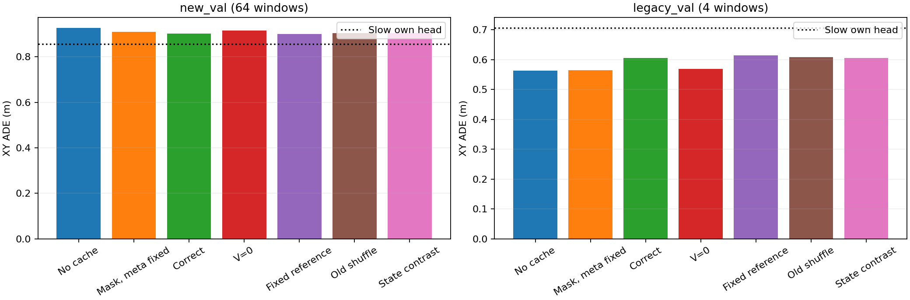
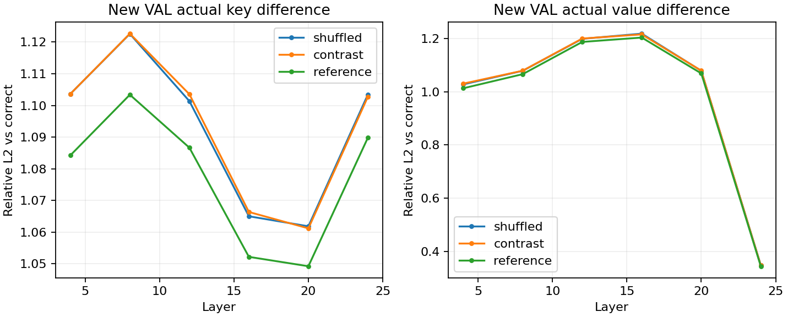
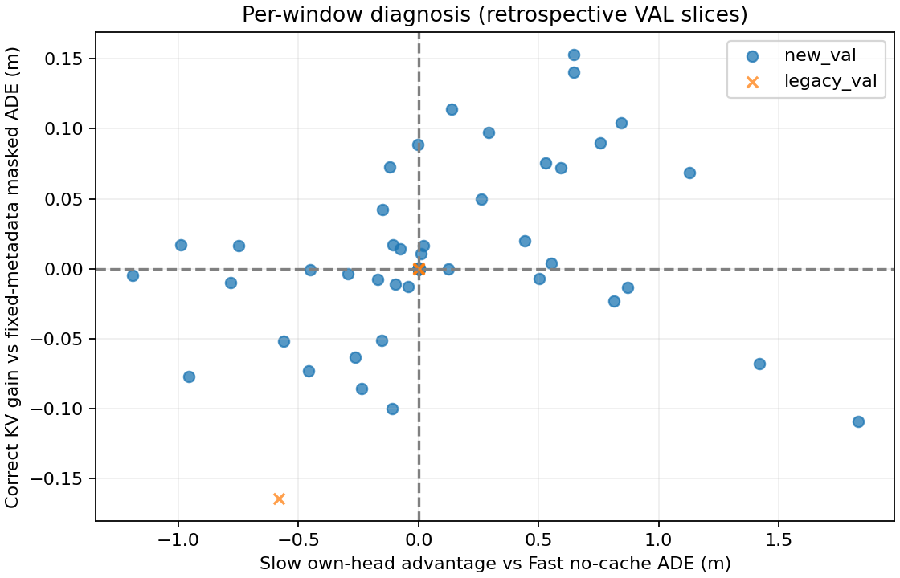
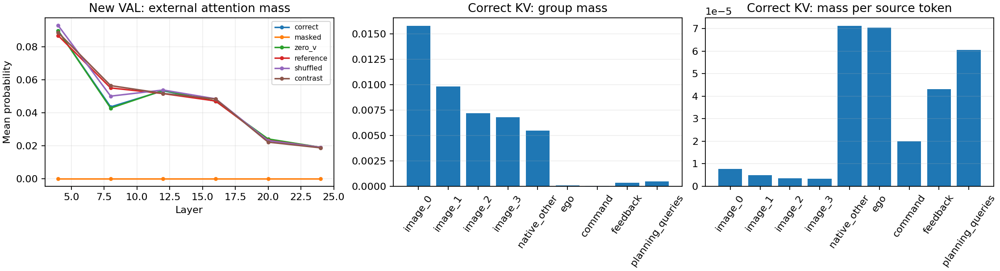

# 固定检查点的 Slow KV 内容诊断

本轮沿用256窗口训练后的联合检查点，只做推理诊断：区分缓存是否存在、外部K/V的具体内容、缓存元数据和注意力分配。没有新增训练更新，也没有准备新数据。结果限定于此前已观察过的两个新VAL日志64窗口和一个legacy日志4窗口，不作为独立TEST或闭环成绩。

## 实测结论

**当前检查点尚未稳定利用“与当前场景对应的Slow内容”。错配替换失败、仅因原错配条件太接近而看不出区别，已经不再是优先解释；具体瓶颈仍不能在编码、跨模型表示对齐和训练优化之间唯一定位。** 当前证据更支持先检验内容消费与训练目标，再扩大调度机制。

所有下表均为同一联合检查点。ADE/FDE单位为m；新VAL来自两条日志，legacy来自一条日志。

| 推理条件 | 新VAL64 ADE / FDE | legacy VAL4 ADE / FDE |
| --- | ---: | ---: |
| 无缓存none | 0.926879 / 2.028088 | 0.562372 / 1.567789 |
| 固定元数据，仅屏蔽外部列 | 0.910012 / 1.950842 | 0.564490 / 1.594949 |
| 正确KV | 0.901954 / 1.956742 | 0.605460 / 1.612471 |
| 保留正确K，V=0 | 0.915214 / 1.955139 | 0.569270 / 1.591461 |
| 固定TRAIN参考KV | 0.901131 / 1.954052 | 0.613427 / 1.616392 |
| 原错配KV | 0.903351 / 1.956239 | 0.608604 / 1.616098 |
| 增强条件错配KV | 0.904301 / 1.959422 | 0.604715 / 1.612029 |
| Slow自身Head（另一读出路径） | 0.856643 / 1.793702 | 0.705724 / 1.489256 |

正确KV相对固定元数据屏蔽的平均ADE优势为8.06mm，39/64个窗口改善，但FDE反而高5.90mm。正确相对原错配只有1.40mm优势，相对增强错配为2.35mm；固定参考的平均ADE还比正确低0.82mm。这些毫米级排序不能视作稳定性能差异。正确相对屏蔽的逐窗口ADE变化中位数只有−0.077mm，平均改善并不均匀。

无缓存→固定元数据屏蔽已有16.87mm平均ADE变化，但该比较混合元数据与注意力实现路径，不能说已单独证明“元数据造成了收益”。V置零也没有保留正确KV的全部表现：相对屏蔽ADE恶化5.20mm。**不能把通路描述为完全不读Value，也不能把全部增益归因于softmax分母。** 结果与共性表示/条件化以及注意力分配参与作用相容，尚未区分各自贡献。

legacy中正确KV比同检查点none差43.09mm；增强错配与正确仍接近。新VAL速度≥10m/s的10个窗口中，none/屏蔽/正确/参考ADE为1.0159/1.1319/1.0727/1.0698m：正确虽好于屏蔽，仍劣于原无缓存，参考也没有比正确差。完整速度/日志/时域/航向指标保留在[result.json](../evidence/slowfast_kv_content/result.json)。



### 错配是否真的改变了信息

| 新VAL错配 | 跨日志 | 不同导航命令 | 平均当前速度差 | 独立donor数 |
| --- | ---: | ---: | ---: | ---: |
| 原错配 | 64/64 | 52/64 | 5.89m/s | 64 |
| 增强错配 | 64/64 | 64/64 | 10.07m/s | 5 |

六层K和V在全部新VAL/legacy替换比较中都实际发生变化，没有相同payload被误当作错配。新VAL增强错配的K相对L2约1.06–1.12；前五层V约1.03–1.22，末层V约0.347。原错配的原始KV差异与增强错配很接近。原对照已非简单的“没有换成功”，增强可观察条件反差后正确优势仍很小。

这只能证明张量实际不同，不能证明所有变化都包含与规划有关的语义。增强错配仅五个独立donor，固定参考只有一个；不据此推断任意错配或任意常量KV都有相同表现。完整候选/来源及逐层、逐Token组差异见[protocol.json](../evidence/slowfast_kv_content/protocol.json)、[records.jsonl](../evidence/slowfast_kv_content/records.jsonl)。



### Slow更准时，Fast有没有接住优势

“明显优势”定义为Slow比Fast-none的ADE至少低0.1m且20%，在运行前锁定。新VAL符合条件的17个窗口覆盖两个日志（8/9），速度分布为低速1、中速10、高速6；导航索引0/1/2/3分别2/11/2/2个。

| 新VAL17个明显优势窗口 | ADE (m) | FDE (m) |
| --- | ---: | ---: |
| Slow自身 | 0.863157 | 1.481537 |
| Fast-none | 1.584765 | 2.978752 |
| Fast固定元数据屏蔽 | 1.699537 | 3.151938 |
| Fast正确KV | 1.654242 | 3.134260 |
| Fast原错配 | 1.654550 | 3.124346 |
| Fast增强错配 | 1.658511 | 3.134359 |
| Fast固定参考 | 1.649567 | 3.118995 |

正确KV在12/17个窗口好于屏蔽、9/17个窗口好于none，平均比屏蔽好45.29mm，但比Fast-none差69.48mm；正确相对原错配仅好0.31mm，参考反而好4.68mm。即使在Slow自身有明显能力优势的窗口，当前Fast也没有稳定利用正确内容缩小差距。所有Slow较好的42个窗口同样如此：Slow/Fast-none/Fast-correct ADE为0.4657/0.7624/0.7791m。

这不是“Slow没能力”的充分解释，也没有证明任务相关信息一定已经编码在可导出的六层K/V里。Slow最终Head和Fast外部KV读取是不同路径。优势切片只按XY ADE定义；整体新VAL上Slow航向MAE为0.06782rad，反而高于Fast-correct的0.06057rad，不能概括为所有指标都更强。本切片按GT事后分析，不能当成独立确认或用它重选本轮检查点。legacy没有符合明显优势阈值的窗口。



### 实际读取强度

新VAL上，正确KV在第4/8/12/16/20/24层的平均外部注意力占比约为8.97%/4.35%/5.33%/4.70%/2.38%/1.89%；不同来源的占比曲线接近。它不是完全关闭，但低占比不能单独证明有用或无用。

源视觉Token共8160个，占8255源Token的98.85%；跨六层平均占约3.963%的总注意力概率，约占外部总概率的86.1%。源原生其他Token仅77个，每Token平均概率约7.13e-5，高于四个视觉帧每Token的3.33e-6–7.75e-6；Ego、反馈、Planning Queries的每Token概率也较高。总占比与每Token占比必须同时看。**这不构成attention sink的判定，也不能说明反馈或Slow Queries的任务信息已被有效读取。**

末层外部/自身加权Value的平均范数分别为1.04/37.20，测量在sigmoid gate和输出投影之前。范数不具有可直接相加的“规划贡献百分比”解释。源视觉早期历史帧占比高于最新帧，也是待解释的观察，不据此断言模型采用了某种语义策略。



### 验收与下一步边界

完成68×7=476个主要条件及一次额外屏蔽不变性核对，耗时364.4s，H800峰值allocated7.94GiB。历史204个none/fresh/shuffled预测逐位复现，最大差异0；固定元数据下屏蔽正确/错误内容的预测差异0。所有模型参数版本、适配器/新增模块hash及源KV/位置/Mask版本保持，执行源码与锁定协议SHA一致。625项回归测试通过。[verification.json](../evidence/slowfast_kv_content/verification.json)与[SHA256.json](../evidence/slowfast_kv_content/SHA256.json)提供核验记录。没有新训练或数据/权重下载。

现在不宜把下一步简单定为继续堆步数，也不能据此否定KV协作的上限。更有信息量的训练对照是：同初始化、样本、预算，比较正确KV训练与固定/错配KV训练，同时量化Fast损失与Slow自身损失到Slow各模块的梯度量级及方向。这能继续区分场景信息学习和共有条件化/训练路径效应。本轮没有执行这些新训练、改架构、增加新loss或门控。

## 为什么补这一轮

上一轮同一联合模型的新VAL ADE为：关闭KV0.9269m、正确KV0.9020m、错配KV0.9034m。原“关闭KV”同时将元数据Token换成可学习的无缓存Token，所以不能单靠它判断外部内容的作用。梯度连通只说明通信通路可训练，Slow自身Head更准只说明它有规划能力；两者均不能替代Fast实际读取正确内容的证据。

## 固定条件与干预

使用`outputs/slowfast_v11_expanded/run_01/joint_final.pt`，核对其SHA、基座资产、原图/metadata身份、TRAIN统计量和固定反馈。所有条件共享权重与当前观测。六层源K/V来自完整Slow Prefill；所有带缓存条件沿用当前正确快照的原始多模态位置、Token数量/有效布局和`[age,dx,dy,sin(dyaw),cos(dyaw),valid]`元数据。布局不一致直接报错，不缩放、插值或截断KV。

| 条件 | 外部注意力列 | 外部K/V | 元数据 |
| --- | --- | --- | --- |
| none | 无 | 无 | 原生无缓存Token |
| correct | 可读 | 当前场景 | 当前缓存元数据 |
| masked | 全部屏蔽 | 保留当前场景数据 | 与correct相同 |
| zero_v | 可读 | 保留当前K，V全部为零 | 与correct相同 |
| reference | 可读 | 固定TRAIN参考快照 | 与correct相同 |
| shuffled | 可读 | 原实验错配快照 | 与correct相同 |
| contrast | 可读 | 更强可观察条件错配 | 与correct相同 |

`masked`直接把外部列的Attention Mask设为不可见，`enabled=True`保持元数据编码与六层融合路径；不是Value乘零。`zero_v`仍参加softmax，并可能改变Fast自身Token的权重。对固定某层Q/K，置零V不改变该层logit；完整六层前向中，早期干预会改变后续Query，因此不能要求所有层注意力占比与correct相同。

`masked`与历史`none`还混合了元数据Token差别和原生/重算注意力路径差别，不能将两者的输出差直接命名为纯元数据效应。

### 错配与参考来源

原新VAL64全部跨日志错配；legacy只有一条日志，其4个错配在日志内部交换。原规则不依据导航/速度反差选择。

`contrast`先限制在同一split/cohort，优先另一日志，再优先不同导航命令，最后最大化当前原始速度差；同分按Token排序。选择不读取GT、未来轨迹、Slow预测或模型误差。保存全部候选的命令差/速度差/跨日志信息及最终来源。这是导航/动态条件反差，不能保证图像语义完全不同；强错配允许重复使用同一donor，因此还需报告独立donor数量。

`reference`固定取TRAIN中字典序第一个Token，与目标和误差无关。它只是一项故意无效的离线内容干预，不是合法部署缓存、训练标签或可报告的部署策略；其来源身份不会伪装成当前真实来源。固定参考不能代表所有可能的常量KV。

## 观测哪些内部量

[content_diagnostics.py](../slowfast_v11/content_diagnostics.py)以仅推理、不可嵌套的临时探针包装现有`planning_attention`；退出或异常后恢复函数。正常条件先调用原SDPA并直接返回其输出，不用手工参考注意力替代真实输出。

- 对六层实际K/V，记录整体和各Token组的相对L2、余弦、RMS差与完全相同检查。包括四个视觉帧组、原生其他Token、Ego、导航、8个反馈Token及8个Slow Planning Queries。
- 用相同的RoPE后Q/K、GQA重复、因果/有效Mask计算float32参考概率，报告外部注意力占比、各Query占比、各源Token组总占比和每Token占比。这些是参考统计，不声称与BF16内核逐位相同。
- 记录外部Value、Fast自身Value和两者和的加权输出范数，均在sigmoid gate和`o_proj`之前。范数不等于下游轨迹的因果贡献，各组概率也不等于其信息重要性。
- 每个目标同时保存同一次Slow Prefill的自身轨迹预测；不把Slow Head的优劣直接当成KV可消费性的证据。

## 配对分析与限制

整体、新日志、速度分层和legacy分别报告。额外做两组事后诊断：Slow自身ADE优于Fast-none的所有窗口，以及至少降低0.1m且20%的“明显优势”窗口。阈值在运行前固定，样本数与组成一起保留；这是基于GT的回顾性切片，不是独立验证或后续训练样本选择规则。

主比较为同一联合权重下`correct`与固定元数据`masked`、原错配、强条件错配及固定参考的配对差。统一报告ADE/FDE、航向、逐时距误差和逐窗口改善数量。相邻窗口并非独立episode，本轮不计算基于独立帧假设的显著性。

## 复现

在同一依赖环境、模型/原图和原训练产物可用时：

```bash
export FLA_TILELANG=1
export CUBLAS_WORKSPACE_CONFIG=:4096:8
export CUDA_HOME=/path/to/matching/cuda-toolkit
python -m tools.diagnose_slowfast_content \
  --run outputs/slowfast_v11_expanded/run_01 \
  --output outputs/slowfast_kv_content/run_new
python -m tools.report_slowfast_content \
  --run outputs/slowfast_kv_content/run_new \
  --output evidence/slowfast_kv_content \
  --test-xml outputs/slowfast_kv_content/final_tests.xml
```

输出目录必须不存在。先写入协议，再逐窗口保存预测/内部统计。任何历史none/fresh/shuffled预测非零差异都会失败；同时核对模型参数、源KV/位置/Mask没有修改，并在预定第一个VAL窗口检查固定元数据时被屏蔽的正确/错误内容输出完全一致。CPU小模型测试另验证六层Context隔离和探针恢复。

源码、可迁移JSON和图表可提交；原图、基座、checkpoint及完整KV留在本地。该入口仍是单卡、离线、固定检查点诊断，不包括新训练、Future Head、真实年龄、异步调度或闭环。
