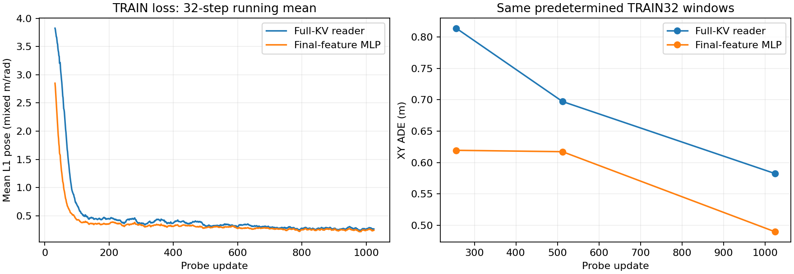
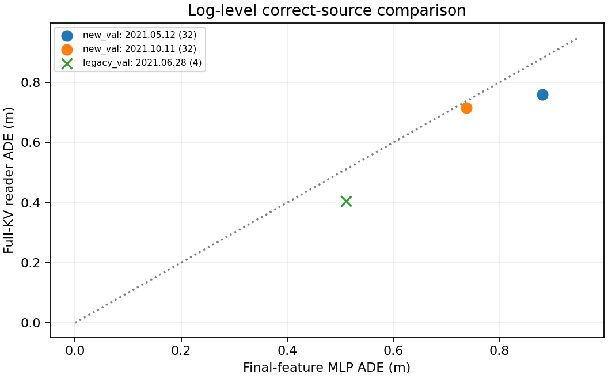
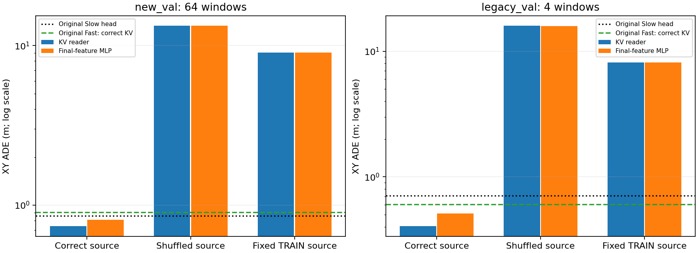
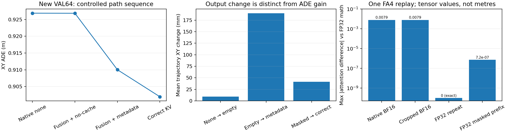

# 冻结 Slow 的可读性与空路径诊断

本轮验证了：**既有冻结 Slow 的完整六层 KV，可以被重新训练的小型 Reader 读出与正确来源有关的轨迹信息。** 新 VAL64 的 KV Reader ADE 为 0.737662m，最终 Planning 特征新 Head 为 0.809404m。更换来源令两者误差显著增加。这没有证明新视觉推理，也没有证明原 Fast 已充分消费 KV；充分可训练的专用 ActionExpert 是另一个独立实验，当前结果不代表其结论或架构上限。

## 范围与固定训练协议

源为 expanded joint step800，SHA256 `448571f4d543913a4d93471781a1ecf4aa392078f2aa2dafa3816be43f9f0ae9`。保留 TRAIN256/四个日志、新 VAL64/两个日志、原 VAL4/一个日志。两组 VAL 已用于先前诊断，不能重新称为未观察过的 TEST；同一日志相邻窗口也不是独立路线。新 VAL 与原 VAL始终分开。

Slow/Fast 权重冻结且没有更新；原始图像、Ego、导航和固定历史 Fast 数值反馈不变。专家未来轨迹只进入读出训练监督和指标，没有作为缓存或 Reader 输入。324 次 Slow prefill 导出的原 Head 输入能逐位重现原预测；完整 K/V 形状 `[324, 6, 8255, 512]`、BF16、原始 K/V 共 32,865,730,560 bytes（30.61GiB）。九类源 token、三轴位置和 mask 均保留，没有池化或截断。RMS 缩放只由 TRAIN256 推导，使用逐层正标量可逆缩放，不对每个 V 做去均值或归一化。

两个新初始化的诊断读出分别为：完整 KV 的六路 Attention Reader（1,002,553 参数），以及与原 Slow Head 相同拓扑的 `LayerNorm→Linear(256)→GELU→Linear(3)` 最终八个 Planning 特征 MLP（529,411 参数）。后者没有继承原 Head 权重。

每个 Reader 训练1024步、batch8、8192个样本曝光，即 TRAIN256 的32个完整 epoch；相同 seed42/目标顺序。AdamW LR5e-4、WD0.01、clip1，32步预热后 cosine 衰减到10%。Loss 是既有 mean L1 pose，混合 m/rad；ADE/FDE 只计算 XY，heading 单独报告。固定 TRAIN32 在256/512/1024步观察曲线，最终固定预算才评估 VAL；不据 VAL 选择或延长训练。两者不是此前 Fast 的560次 fresh 条件训练的等预算对照，也没有证明收敛。



## 正确来源的绝对规划误差

下表由逐窗口预测以 NumPy float64 重算；`result.json` 保留原始 float32 Torch 汇总，核对的最大数值差为 1.68e-06，不影响这里的判断。

| Cohort | 读出 / 基线 | ADE (m) | FDE (m) | heading MAE (rad) |
| --- | --- | ---: | ---: | ---: |
| 新 VAL64 | 完整 KV Reader | 0.737662 | 1.742476 | 0.040849 |
| 新 VAL64 | 最终特征 MLP（含 LayerNorm） | 0.809404 | 1.769941 | 0.063666 |
| 新 VAL64 | 原 Slow Head | 0.856643 | 1.793702 | 0.067824 |
| 新 VAL64 | 原 Fast：正确 KV | 0.901954 | 1.956742 | 0.060567 |
| 新 VAL64 | 固定 Fast 反馈生产者 | 1.535061 | 3.193308 | 0.077347 |
| 原 VAL4 | 完整 KV Reader | 0.404186 | 0.750961 | 0.006866 |
| 原 VAL4 | 最终特征 MLP（含 LayerNorm） | 0.510876 | 1.184173 | 0.010841 |
| 原 VAL4 | 原 Slow Head | 0.705724 | 1.489256 | 0.019027 |
| 原 VAL4 | 原 Fast：正确 KV | 0.605460 | 1.612471 | 0.018067 |
| 原 VAL4 | 固定 Fast 反馈生产者 | 1.029101 | 2.964584 | 0.028190 |

原 Fast 无缓存的新 VAL ADE 为 0.926879m。KV Reader 相对原 Fast 正确 KV 的平均 ADE 改善为 0.164291m；逐窗口胜负、配对差值以及速度分层见 [window_metrics.json](../evidence/slowfast_readability/window_metrics.json) 和 [stratified_summary.json](../evidence/slowfast_readability/stratified_summary.json)。不能只用总体平均替代逐日志检查。

平均收益没有覆盖多数窗口：新 VAL64 中 KV Reader 相对原 Fast 正确 KV 改善 29 个、退化 35 个；逐窗口 ADE 改善的中位数为 -0.000911m（负值表示 KV Reader 更差）。因此只能说部分误差较大的窗口拉低了平均误差，不能写成逐窗口一致改善。原 VAL4 也只有一个移动窗口改善，其余三个静止窗口略退化。

| 新 VAL 速度组（m/s） | 窗口数 | KV Reader ADE | 原 Fast 正确 KV ADE | KV Reader 改善窗口 |
| --- | ---: | ---: | ---: | ---: |
| low | 27 | 0.131335 | 0.254964 | 8/27 |
| mid | 27 | 1.411094 | 1.485699 | 13/27 |
| high | 10 | 0.556480 | 1.072713 | 8/10 |

low 为<1、mid 为[1,10)、high 为≥10m/s；ADE 单位均为米。速度组仍来自两个日志，不能当作独立场景实验。

| 日志 | 窗口数 | KV Reader ADE (m) | 最终特征 MLP ADE (m) |
| --- | ---: | ---: | ---: |
| `2021.05.12.23.36.44_veh-35_02035_02387` | 32 | 0.758923 | 0.881476 |
| `2021.10.11.02.57.41_veh-50_00352_00535` | 32 | 0.716401 | 0.737331 |
| `2021.06.28.16.57.59_veh-26_00016_00484` | 4 | 0.404186 | 0.510876 |



## 固定 Reader 后替换来源

| Reader | Cohort | 正确来源 ADE | 打乱来源 ADE | 固定 TRAIN 来源 ADE |
| --- | --- | ---: | ---: | ---: |
| KV Reader | 新 VAL64 | 0.737662 | 13.292412 | 9.042510 |
| KV Reader | 原 VAL4 | 0.404186 | 15.925557 | 8.166488 |
| 最终特征 MLP | 新 VAL64 | 0.809404 | 13.299151 | 9.045120 |
| 最终特征 MLP | 原 VAL4 | 0.510876 | 15.814771 | 8.162687 |

单位均为米。固定参考是预先指定的最小 TRAIN token `006be99cbfcf5751`；打乱来源沿用 split/cohort 内确定性错配。KV 替换保留目标的位置、类型和布局；最终特征 MLP 使用相同来源选择。错配与固定 TRAIN 来源均为刻意无效的离线输入干预，不能当作合法在线缓存。



这些差异支持“来源相关的信息能被读出”。完整 KV 含 Ego、导航、固定旧 Fast 候选轨迹，以及视觉/context/规划 query；没有去掉这些非视觉线索的消融，因此**不能把收益归因为新视觉推理或增量世界知识**。固定参考只有一个，错配可能有分布差异。32个 epoch 的监督也能教新 Head 利用已有运动线索，不能据此宣称更强泛化或完整 KV 架构上限。

## 空路径、metadata 与数值后端

对全部68个 VAL 窗口比较四条路径：native 无缓存；运行六层 fusion、屏蔽所有外部列且强制 no_cache token；相同 fusion/mask 保留正常 metadata；正确 KV。两条屏蔽路径都保持 enabled=True，因此 metadata 效应是在同一 fusion 实现内比较。

| 新 VAL64 路径 | ADE (m) |
| --- | ---: |
| native none | 0.926878627 |
| fusion + masked + no_cache token（empty） | 0.926846486 |
| fusion + masked + 正常 metadata | 0.910012330 |
| fusion + 正确 KV | 0.901953781 |

none→empty 的最大单个 XY 坐标变化为 0.07532501m，故不能称空路径逐位等价；但整体平均 ADE 变化仅 -0.032141mm。empty→metadata 的平均 ADE 变化为 -16.834156mm；这是同一路径内的 metadata 对照。本轮全部是fresh缓存，metadata为同一常量；这个对照识别缓存模式Token的切换，不证明年龄或相对位姿建模已有收益。上述量分别是最大坐标变化与平均误差变化，不能混为一个“数值噪声”大小。原 VAL4 的独立数值及逐层差异见 [path_summary.json](../evidence/slowfast_readability/path_summary.json)。完整 Context 张量的对照只在首个预声明窗口采集，不能把该检查外推成68次全 Context 验证。

单个预声明窗口的 FA4 数值审计重放原生 helper，post-gate 输出逐位相同，重建 RoPE Q/K 也逐位相同。原生完整 query 使用 FLASH；裁剪到八个 query、显式重复 KV 的 bridge 几何使用 efficient SDPA。FP32 MATH 下 cropped GQA 与显式 repeat 逐位相同；增加全部被屏蔽的外部前缀后，最大 attention 张量差为 7.15255737305e-07。这提供了一个真实的数值路径差异来源，没有发现缺失 Q/K norm 或重复 gate 的证据；但没有执行全长 query FP32/MATH 或全模型后端消融，不能把完整规划差异全部归因于已测的单层后端，也不能直接把 attention 张量误差称为米。



## 重现、测试与边界

原 none/masked/correct 的204个保存预测均精确重现，324个原 Slow Head 输出精确重现，源参数和完整缓存未变。独立进程重载两个新 Reader，对每个 Reader 的16个新 VAL 窗口×3种来源条件复核，合计96个预测条件，最大差0；这个重载覆盖不包括全部68个 VAL，不能描述为全 VAL 逐位恢复。

历史回归记录为652 passed、0 failures/errors/skips，XML 时间为 `2026-11-07T05:25:57.798858+00:00`。它只证明该次测试快照；其后 checkpoint helper 或独立控制代码的修改不由这条历史记录自动覆盖。详见 [verification.json](../evidence/slowfast_readability/verification.json)、[reload.json](../evidence/slowfast_readability/reload.json)、[SDPA 审计](../evidence/slowfast_readability/sdpa_audit.json) 和 [源身份](../evidence/slowfast_readability/source_hashes.json)。原始训练/诊断 JSON 和逐窗口记录已脱去机器绝对路径，数值保留；完整 K/V、图像、`.pt` 权重和3GB reload 输入未提交。导出文件校验见 [SHA256.json](../evidence/slowfast_readability/SHA256.json)。

本轮没有启动 Stage3 Fast 通信训练。用户另行授权的145M专用24层 ActionExpert/完整 Fast 读出控制使用独立协议和报告；它们的训练状态、结果与本报告分开，不能由这里的小型 Reader 成绩代替。可读性、正确来源依赖、绝对规划质量和原 Fast 能否有效消费 KV 是四个不同问题。

CPU 导出命令：

```bash
CUDA_VISIBLE_DEVICES='' OMP_NUM_THREADS=2 OPENBLAS_NUM_THREADS=2 \
python -m tools.report_slowfast_readability \
  --run outputs/slowfast_readability/run_01 \
  --output evidence/slowfast_readability
```
