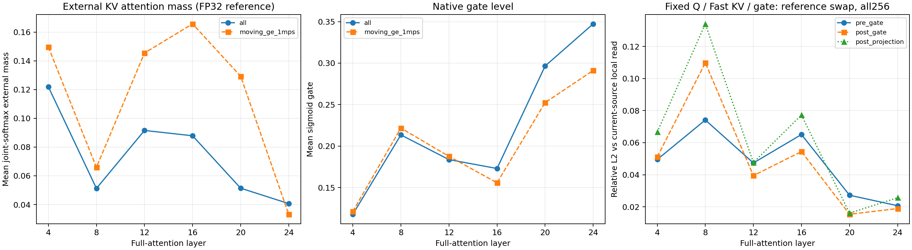
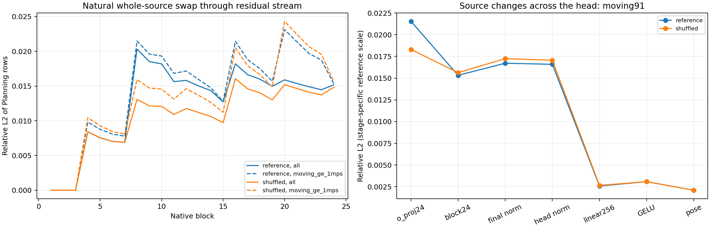
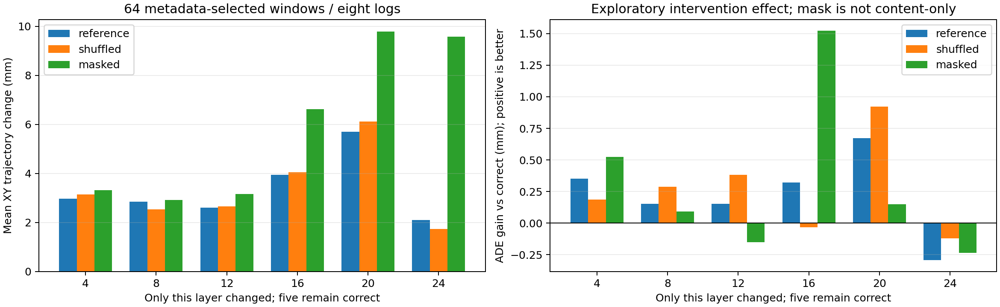
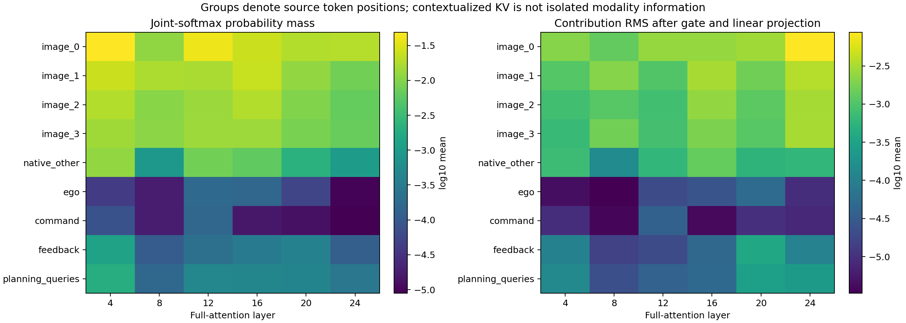

# 冻结检查点的六层 Direct-KV 读取定位

本轮结论：**Fast 确实读到了随来源变化的 Slow KV；差异没有被 gate 或 o_proj 统一清零，也能到达轨迹 Head。但这些差异尚未形成正确来源的规划优势。** 后续轨迹读出值得检查；当前证据不能把失败归为 Slow 没先训强、KV 不可读或某一个 Head 层已经被证明有错。

保持原 2B 来源冻结，0.8B 和所有 Head 也冻结。没有重新训练 Slow，没有增加 Reader、残差结构、门控或新数据。Slow 自身轨迹 ADE 不作为其 KV 质量的判据。

## 固定对象与验收

使用上一轮 `full_correct_kv/final.pt`，以及经身份验证的原冻结 Slow 原生 KV 和 Fast 冻结视觉缓存。原图 1920×1080，仅原定 bottom padding；2Hz 四帧、Ego、官方导航命令、原反馈生产者、归一化和 `8×3` 输出协议不变。Slow 本轮不重新执行 Prefill；读取的是已经验证来源、内容和布局的缓存。

| 项目 | 实际结果 |
|---|---|
| 数据 | 已观察的 VAL256／8 个 recording groups，各 32 窗口 |
| 整体换源 | correct、TRAIN 固定 reference、原跨日志 shuffled；共 768 次 |
| 固定 Q 局部比较 | 同一层 Q、Fast K/V、gate 不变，只更换外部 K/V；另测 K-only、V-only、V=0、masked |
| 单层干预 | 64 窗口，每日志 8 个，导航／速度分层；6 层 × reference/shuffled/masked，共 1152 次 |
| 干预后清理复测 | 64 次原正确来源推理，全部精确恢复 |
| 原预测复现 | 768/768 与上一轮三来源预测逐项相同 |
| Context 隔离 | 三种整体换源下，24 层全部 Context 行逐位相同；不将此计数扩展到单层干预 |
| 参数／来源不变 | Fast 全部参数前后 SHA 相同、版本不变；源 KV 版本不变 |
| 新训练／下载 | 0 updates／0 bytes |

自然换源会改变早期层的 Planning 状态，继而影响后层 Q 和 gate。固定 Q 比较只在正确来源前向内做额外只读计算，使用同一层当前 Q 和 Fast K/V；二者不能混为同一种读取敏感性。探针始终返回原生 SDPA 的原结果，不用 FP32 reference 替换模型计算。

## 六层均有内容敏感性，并非 gate 统一关闭

以下为速度 ≥1m/s 的 91 个窗口／7 个 recording groups；在输入上预先固定该速度界限。数值为逐窗口相对 L2 的平均值，reference 来源替换在固定本层 Q、Fast K/V 和 gate 下进行。

源张量本身有明确差异：reference 的 Value 相对 L2 变化均值在六层约为 0.35–1.20。这个数值描述张量变化，不等同于信息量或任务价值。

| 层 | 外部 attention mass | gate 均值 | gate 前变化 | gate 后变化 | o_proj 后变化 |
|---|---:|---:|---:|---:|---:|
| 4 | 14.96% | 0.121 | 6.09% | 6.11% | 8.12% |
| 8 | 6.59% | 0.222 | 7.62% | 11.35% | 12.98% |
| 12 | 14.55% | 0.188 | 6.05% | 6.55% | 6.90% |
| 16 | 16.57% | 0.156 | 7.35% | 8.32% | 12.94% |
| 20 | 12.93% | 0.252 | 6.88% | 3.62% | 3.77% |
| 24 | 3.32% | 0.291 | 1.34% | 1.30% | 1.85% |

`o_proj` 后变化的逐窗口中位数依次为 7.81／13.41／6.79／13.24／3.54／1.16%，不是仅由少数离群窗口造成。K-only 和 V-only 替换也都有可测影响。

gate 会降低绝对 RMS，但正确来源的基准激活也同时缩小，因此相对变化不一定下降。部分层的相对变化反而增大，不能仅凭 gate 均值低就认定它屏蔽了 Slow 内容。`o_proj` 也没有把差异统一抹除。



图左／中同时给全体 256 和移动 91 窗口；右图给全体 256，移动子集的六层值见上表。

## 后续读出有相对衰减，Head 第一线性映射值得检查

整体换成 reference 后，移动子集的相对差异如下。这是自然传播结果，包含前层变化；不能把它解释成每一层独立注入的大小。

| 位置 | 相对变化均值 |
|---|---:|
| 第 4 层 o_proj 后 | 8.12% |
| 第 4 层残差 block 输出 | 0.98% |
| 第 24 层 block 输出 | 1.53% |
| 最终语言 Norm／Head 输入 | 1.67% |
| Head LayerNorm 后 | 1.66% |
| Head 第一线性层后（256 维） | 0.258% |
| GELU 后 | 0.308% |
| 最终 pose Head 后 | 0.210% |

差异进入残差流时相对于完整状态变小，随后仍能传播到 Head；第一线性映射附近又有明显的相对下降。换成 shuffled 的变化路径类似：Head 输入 1.72%，第一线性层后 0.265%，最终约 0.210%。

**这些比值不能证明某层丢掉了有用信息。** 各位置参考范数、维度、bias 和单位不同；第一线性层处的绝对差异 RMS 为约 0.0143，对应此前 Head Norm 后约 0.0160，并非差异被清零。最终 pose 向量又混合米与弧度，范数仅用于计算通路诊断；实际轨迹变化另以 XY 米报告。现有记录也不包含全部差异向量方向，尚不能判断 Head 是否正确忽略了无用方向，或没有学会利用有用方向。

全体中有 165 个低于 1m/s 的窗口，接近零的预测会放大相对比值；所以不能用全体最终 Head 的相对百分比代替移动子集和绝对轨迹变化。



## 内容变化没有带来正确来源优势，移动子集也一样

| 同一冻结检查点的来源 | 全体 ADE（m） | 移动 91 ADE（m） | 移动子集 XY 预测平均变化 |
|---|---:|---:|---:|
| correct | 0.393248 | 0.924311 | 基准 |
| reference | 0.392893 | 0.923333 | 14.75mm |
| shuffled | 0.392488 | 0.922081 | 15.57mm |

因此，“只是静止样本太多，把来源收益平均没了”也不足以解释现状。对移动窗口，换源确实改变轨迹约 1.5cm，但正确来源仍没有更好的 ADE。这里沿用的是已观察 VAL，不新增显著性或非劣性结论；reference／shuffled 点估计略低也不能直接宣布它们更好。

64 个单层干预窗口每日志固定 8 个，包含全部四种导航命令，33 低速／26 中速／5 高速；没有按 GT 误差或 Slow 优势挑选。

| 仅改这一层，其余五层正确 | reference：平均 XY 变化（mm） | shuffled：平均 XY 变化（mm） | 屏蔽外部列：平均 XY 变化（mm） |
|---|---:|---:|---:|
| 4 | 2.98 | 3.14 | 3.32 |
| 8 | 2.86 | 2.54 | 2.92 |
| 12 | 2.61 | 2.65 | 3.16 |
| 16 | 3.95 | 4.05 | 6.63 |
| 20 | 5.70 | 6.11 | 9.79 |
| 24 | 2.10 | 1.73 | 9.57 |

reference／shuffled 单层替换的平均 ADE 变化均不足 1mm，方向不统一。屏蔽某层有时产生更大轨迹变化，但同时改变外部通路可用性与 joint softmax 归一化，不是纯粹移除当前场景语义。不能由屏蔽第 24 层比换源影响更大，推断第 24 层已在利用正确场景；也不据这 64 个窗口的均值删层或选择新模型。



## 源位置分组、精度与解释边界

四个图像位置组承接了外部 attention mass 的约 87.5%–97.7%（逐层，全体均值比例），但它们本身占 8160/8255 个源位置。报告保留了每 token mass、各 head／query 的值及投影贡献 RMS，不能把总 mass 直接解释成偏好或规划贡献。KV 是上下文化状态，位置类型不是独立信息模态；本轮没有做纯视觉的因果贡献分离。



FP32 joint-softmax reference 与真实 SDPA 的最大相对重建差约 0.241%；含一次 bias 的分解投影最大重建差约 0.510%；query-only 与真实 full-row 投影最大相对差约 0.0118%。这些是明确记录的数值参考误差，不是随机噪声门槛。局部换源使用真实 SDPA，生产结果没有被这些分解替换。各组 contribution RMS 不能直接相加成为贡献比例。

本轮可以排除的是“通路完全不读取内容”以及“gate/o_proj 把所有差异清零”这两种笼统解释。现有证据支持：**内容可读且可传播，当前训练检查点对这些差异的任务利用仍弱；后续读出是值得定位的环节。** 它不证明 Head 必须更换，不要求 Slow 轨迹 Head 先打败 Fast，也没有给某种损失或训练方案开出唯一处方。

Slow 自身的既有预测另有[辅助审计](evidence/kv_read_trace/old_complement_diagnostic.json)：相对上一轮独立训练的完整语言 Fast-only 对照（ADE 0.416926m），它在 50/256 窗口更好，其中 14 个窗口改善超过 20cm，横跨 7 条日志。这个对照不同于本报告主要定位的正确 KV 检查点（ADE 0.393248m）；这些 GT 事后切片不能作为在线选择器，也不承担冻结 KV 的质量判定。

## 复现与证据

已有原图数据、权重、严格 cache 和初始身份资产的机器可执行：

```bash
python -m tools.trace_direct_kv --output outputs/slowfast_kv_read_trace/run_new
python -m tools.report_kv_read_trace \
  --run outputs/slowfast_kv_read_trace/run_new \
  --output outputs/slowfast_kv_read_trace/report_new
```

CUDA、FLA、TileLang 和精度环境沿用 [直接 KV 全语言实验](SLOWFAST_DIRECT_FULL.md)。当前运行约 489.64 秒，峰值 allocated 4.47GiB；这是冻结缓存上的观测与干预，含额外参考计算和 CPU 同步，不是训练显存或部署端到端延迟。

[协议](evidence/kv_read_trace/protocol.json)、[真实 GPU 验收](evidence/kv_read_trace/result.json)、[六层与读出汇总](evidence/kv_read_trace/report_summary.json)、[独立审计摘要](evidence/kv_read_trace/independent_audit_summary.json)、[独立发现](evidence/kv_read_trace/independent_findings.txt)、[移动子集逐层 CSV](evidence/kv_read_trace/moving_layer_reference.csv)、[回归 XML](evidence/kv_read_trace/regression.xml) 和 [SHA256SUMS](evidence/kv_read_trace/SHA256SUMS) 随源码保存。850 项回归中 849 通过、1 个 GPU 启动项跳过；另有这次真实 H800 冻结推理验收。

独立 stdlib＋NumPy 审计复核全部行、原预测、64 窗口选择、位置分组、概率记账与轨迹效应；最大重算轨迹效应误差 3.34e−7m，汇总差 3.63e−7。该审计没有独立加载完整模型权重；模型不变结论来自 runner 的全参数 SHA、版本和真实推理检查。

完整逐窗口标量记录、干预轨迹和完整独立审计保存在 `outputs/slowfast_kv_read_trace/`，不含在 Git 的轻量摘要中。单独的 `numeric_evidence.tar.gz` 数值证据包为 24,162,252B，[清单与 SHA](evidence/kv_read_trace/numeric_package_receipt.json) 随源码保存；它不含权重或原图。解压到干净源码目录后，运行 `python outputs/slowfast_kv_read_trace/independent_audit/audit_trace.py` 即可进行 stdlib＋NumPy 重算，不需加载模型。若使用 Git 中的 [独立脚本](evidence/kv_read_trace/audit_trace.py)，先复制到 `outputs/.../independent_audit/` 再从仓库根运行，避免把其生成的大审计文件写进源码目录。此轮是固定检查点、已观察日志的离线诊断，不是新的泛化或闭环验证。
