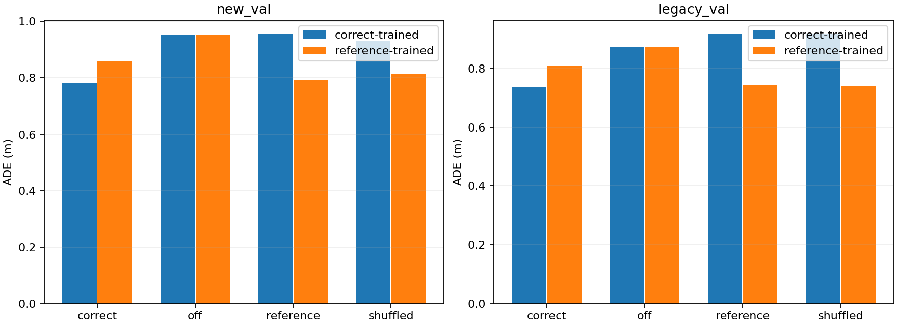
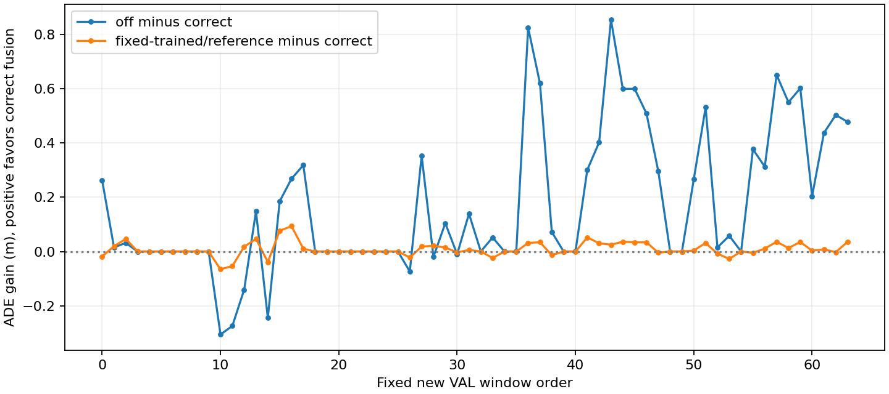
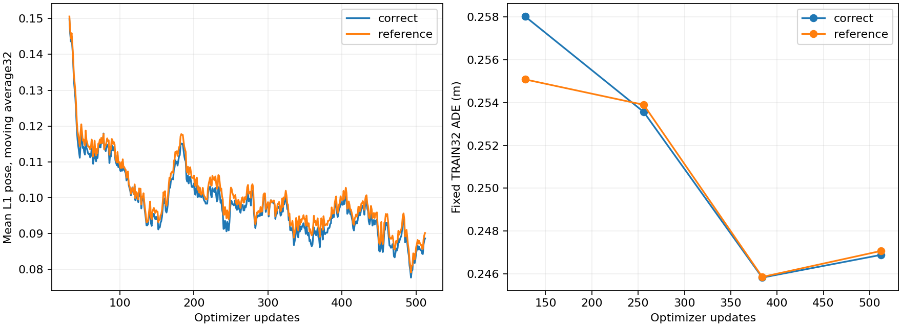

# 冻结 Fast＋Reader 的最小残差融合

完成预声明两臂：correct-source 与 fixed-reference-source，均为512步×batch8=4096新增曝光、16个TRAIN epoch。Fast、Slow、既有Reader和原轨迹Head均未更新，只训练726,017参数融合模块。完整结果和逐窗口证据均保留，不按VAL挑检查点或延长。

**本轮结论：** 本批结果未同时满足预声明的来源增量方向判据，不能宣称已经建立稳定的匹配来源收益。 未通过的比较：2021.10.11.02.57.41_veh-50_00352_00535/reference, 2021.10.11.02.57.41_veh-50_00352_00535/shuffled。 新VAL原Fast/off ADE=0.952469m，正确训练/correct=0.782680m，固定训练/reference=0.791077m。分日志和legacy退化均保留在下表。

固定来源训练对照复现了相对off平均ADE改善的95.05%；这是结果差值的描述，不是可加的因果分解。正确来源相对该对照的平均优势只有8.397mm，逐窗口中位数1.885微米，不能把近零浮点差算成有实际意义的多数窗口改善。日志`2021.10.11.02.57.41_veh-50_00352_00535`中reference比correct平均好72.855mm；日志`2021.10.11.02.57.41_veh-50_00352_00535`中shuffled比correct平均好19.295mm。legacy的平均收益由一个移动窗口贡献，另三个窗口略退化。可见新增任务适配有效，但匹配内容的稳定贡献仍未建立。

## 输入、唯一输出与关闭语义

使用最新完整Fast检查点`02c3964a225efd79e1c06644cbf49228a38a612021f211258e8476e6606882b1`，保留原始1920×1080四帧2Hz、官方Ego4和离散导航command。Fast此轮始终原生无外部KV、原no_cache token。取原Head前八个planning特征F；冻结Reader的六路注意力拼接特征R经小MLP、sigmoid gate、零初始化投影形成delta；唯一输出为原Head(F+delta)。Reader旧轨迹输出不做混合/选择；Reader包含此前学到的K/V投影与位置/group处理，本轮全部冻结，不等价于原生直接KV拼接。

关闭分支跳过Reader和融合hook，直接运行原Fast；不是给Reader全masked，也不是此前0.885010m的Fast屏蔽外部列路径。原Head参数冻结，但训练时不使用no_grad包裹Head，梯度可传入残差。F/R作为冻结特征不接收梯度；融合模块根据当前F与R联合形成残差，未加入导航切换/年龄/动作相容性门控。

两臂相同seed42、融合初始化、无放回epoch顺序和LR；AdamW5e-4、WD.01、clip1、32步warmup后cosine至10%。沿用mean L1 pose(m/rad)，XY ADE/FDE和航向分开。固定TRAIN32于128/256/384/512步观察，两个VAL日志仅终点评估。正确臂训练只用correct来源，参考臂只用固定最小TRAIN来源；各自其他推理来源是干预条件。主额外容量对照为correct-trained/correct-eval对reference-trained/reference-eval，不选择后者的错配条件。

## 终点ADE与来源干预

单位m。off为相同冻结Fast，两臂全部68个窗口的off预测精确相同。

| Cohort | 训练来源 | correct | off | reference | shuffled |
| --- | --- | ---: | ---: | ---: | ---: |
| new_val | correct | 0.782680 | 0.952469 | 0.956434 | 0.931756 |
| new_val | reference | 0.859090 | 0.952469 | 0.791077 | 0.813058 |
| legacy_val | correct | 0.735817 | 0.873215 | 0.916938 | 0.918160 |
| legacy_val | reference | 0.809051 | 0.873215 | 0.742126 | 0.741718 |

新VAL正确训练臂的配对收益如下：比较条件ADE减correct ADE，正值表示correct较好。均保留均值、中位数和胜/平/负窗口数，不能把大幅错配退化视作成功。

| 比较条件 | 平均收益(m) | 中位数收益(m) | 胜/平/负 |
| --- | ---: | ---: | ---: |
| off | 0.169789 | 0.023473 | 41/0/23 |
| reference | 0.173754 | 0.000000 | 32/0/32 |
| shuffled | 0.149076 | 0.000001 | 37/0/27 |
| reference_trained_reference_eval | 0.008397 | 0.000002 | 34/0/30 |

| 日志 | 窗口 | 正确训练/correct | 正确训练/off | 正确训练/reference | 正确训练/shuffled | 固定训练/reference |
| --- | ---: | ---: | ---: | ---: | ---: | ---: |
| `2021.05.12.23.36.44_veh-35_02035_02387` | 32 | 0.824762 | 1.140745 | 1.245126 | 1.142209 | 0.836293 |
| `2021.10.11.02.57.41_veh-50_00352_00535` | 32 | 0.740597 | 0.764192 | 0.667742 | 0.721302 | 0.745860 |
| `2021.06.28.16.57.59_veh-26_00016_00484` | 4 | 0.735817 | 0.873215 | 0.916938 | 0.918160 | 0.742126 |

航向和末端误差避免被ADE隐藏：

| Cohort | 训练/推理条件 | ADE(m) | FDE(m) | heading MAE(rad) |
| --- | --- | ---: | ---: | ---: |
| new_val | correct/off | 0.952469 | 2.138403 | 0.036140 |
| new_val | correct/correct | 0.782680 | 1.918033 | 0.034320 |
| new_val | reference/reference | 0.791077 | 1.931438 | 0.034346 |
| legacy_val | correct/off | 0.873215 | 2.010773 | 0.007561 |
| legacy_val | correct/correct | 0.735817 | 1.756658 | 0.005653 |
| legacy_val | reference/reference | 0.742126 | 1.759773 | 0.005655 |

## 正确性、恢复与边界

原Fast Head输入在全部324个窗口精确重现原生预测。Reader先按历史batch8/final4复现972个保存预测，再以batch1生成融合特征；本批Reader两种batch几何的全部保存预测也精确相同，最大差0。没有比较跨batch的中间特征；融合缓存、最终VAL及在线Reader均固定batch1。本轮B1 standalone Reader新VAL ADE=0.737662m，残差融合尚未超过这个Reader自身的平均位置精度。固定reference特征在全部324窗口逐字节相同；目标索引/位置没有悄悄携带样本条件。原始KV manifest SHA固定为`401fe157104944caf50c8cf2f6397810c8833533afe55d081c001d46a0dd9694`，来自已认证Fast检查点，而非只信当前manifest。

一个预声明TRAIN和一个VAL样本，每臂实际执行原图Fast＋raw-KV Reader＋原Head：共4个检查，off与原Fast精确一致，on与冻结特征计算最大差0。冻结模型参数、tensor版本和参数梯度均核对未变。独立进程两臂全68 VAL×4条件重载及511→512实际训练更新重放均精确一致（参数、AdamW、scheduler、RNG、最终训练batch预测）；范围仅同H800/runtime，不是跨硬件保证。

回归测试658 passed，0失败/错误/跳过，XML SHA`7fff7f6ec4e90a7fb6ceab63458d850f7f38e5df432585e2b62d1283e2c5c8ea`。报告以NumPy float64重算指标，与原float32汇总最大差3.51e-07。训练耗时correct=4.17s、reference=4.05s；全流程含加载/原图提取/验证276.54s，peak allocated 34.076GiB，不是部署延迟。初次pytest默认导入模式因两个test_model同名导致收集冲突；改用--import-mode=importlib后完整通过，没有修改模型。

单seed、TRAIN256/四日志、新VAL64/两日志、legacyVAL4/一日志；这些是已观察过的诊断VAL，不是TEST。Reader已有32epoch任务读出训练，最新Fast已有自身任务适配历史；本轮只在两条新增融合臂间统一预算，不将历史Reader/Expert结果当等预算架构排名。KV包含视觉、Ego、导航、旧候选轨迹，未隔离视觉增量；fresh同步条件不支持缓存年龄、异步闭环结论。只有同时优于off、reference、shuffled和固定训练对照，且逐日志方向一致，才支持本次诊断中的来源匹配增量；广泛稳定收益仍需更多独立日志与训练种子。

本轮没有新下载或backbone训练。此固定324窗口特征缓存入口用于小样本机制验证，不可直接替换manifest用于完整navtrain。源配置、逐步训练、逐窗口预测、速度/日志分层和hash见[evidence索引](../evidence/slowfast_reader_fusion/SHA256.json)。权重、rawKV和冻结特征包仅保存在本地outputs，不提交。
