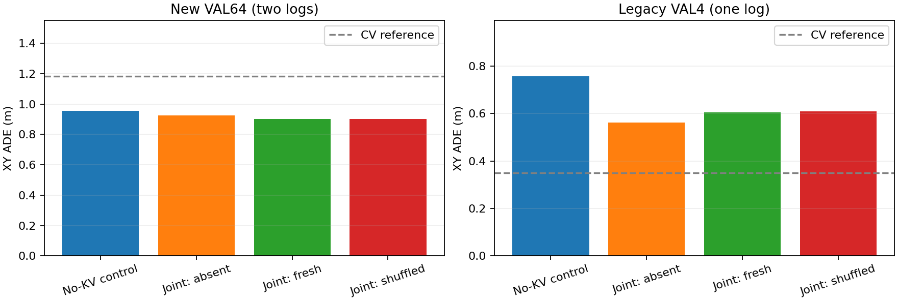
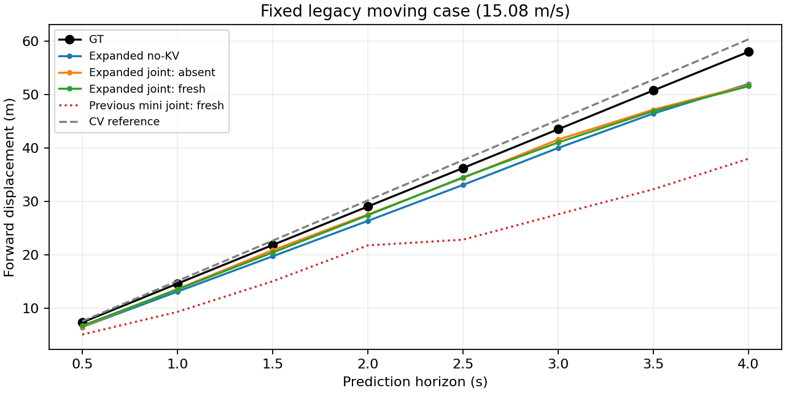
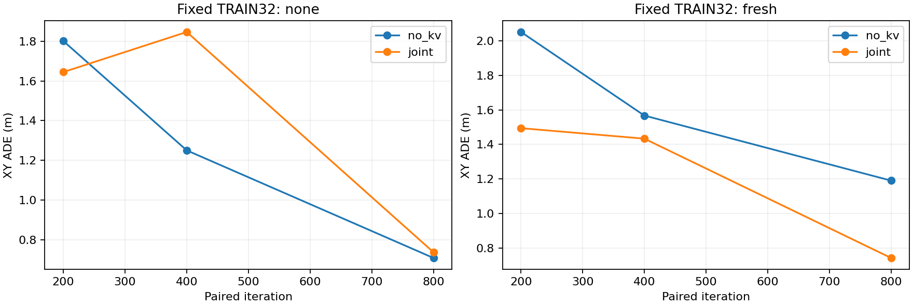
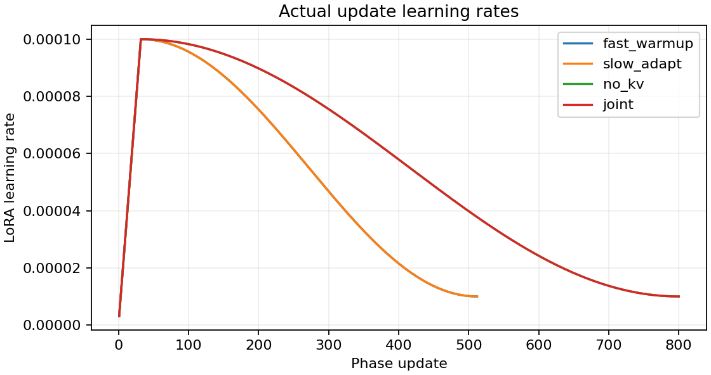
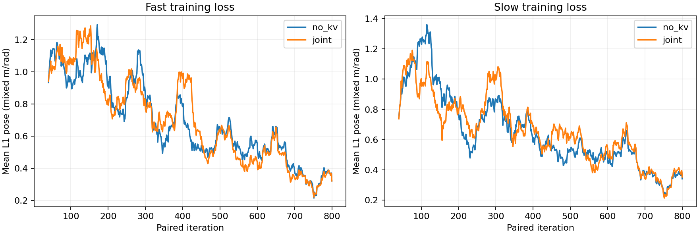

# V1.1 扩数据训练：256 TRAIN /64新VAL

本轮按用户要求扩大训练数据，保持原始图像和快慢架构，完成2624次训练迭代。**规划误差明显改善，但当前仍缺少推理时依赖正确Slow KV内容的强证据。** 下文区分独立模型比较、同检查点KV条件比较和新旧实验比较。

## 数据与划分

使用固定revision的OpenScene **mini 子集**，不是官方完整navtrain。相比原来的12个TRAIN窗口，本轮取4条日志各64个窗口，共256个；另外2条日志各32个窗口构成新VAL64。原VAL日志及其4个窗口保留为单独的legacy VAL，不进入TRAIN或新VAL。

先依据元数据固定日志、split和目标token，再下载其所需图像，缺图不会换样本。候选窗口stride5（2.5秒），历史四帧、未来4秒8点；同日志内未来轨迹仍有重叠，64个新VAL窗口不能视为64个独立环境。两个新VAL日志和原legacy日志都不参与优化、选超参数、选步数或决定续训。没有TEST参与。

TRAIN按当前速度分层选取；只用当前速度，不按未来轨迹或模型误差选样本。原定每日志低速/中速/高速名额为16/24/24，缺少的高速名额按固定规则转给其他可用分层并记录。实际TRAIN为低速64、中速141、高速51个，最高速度约13.58m/s；原来12窗口最高约8.97m/s。这里没有专门训练原VAL那条15.08m/s轨迹。

| 用途 | 相机分片 | 日志 |
| --- | --- | --- |
| TRAIN64 | 5 | 2021.06.09.14.58.55_veh-35_01894_02311 |
| TRAIN64 | 11 | 2021.06.09.14.03.17_veh-12_02584_02970 |
| TRAIN64 | 26 | 2021.08.17.16.57.11_veh-08_01200_01636 |
| TRAIN64 | 7 | 2021.06.08.12.54.54_veh-26_04262_04732 |
| 新VAL32 | 6 | 2021.10.11.02.57.41_veh-50_00352_00535 |
| 新VAL32 | 15 | 2021.05.12.23.36.44_veh-35_02035_02387 |
| legacy VAL4 | 2 | 2021.06.28.16.57.59_veh-26_00016_00484 |

原始1920×1080 JPEG保持字节内容，只在Processor中补边，不额外resize或重编码。获取所需的1293张JPEG，并保留成员SHA；不下载完整相机归档。网络响应体总预算2GB，包含元数据扩展、无关压缩成员、失败读取和重试；默认每个相机前缀最多225MB。分片7在225MB时只取全252/256张预定图片，因此明确修订为仅该分片允许256MB前缀，总预算与所有样本保持不变。元数据只扩展到120MB前缀，完整元数据归档约534MB。父归档LFS身份用于来源记录，不声称部分前缀验证了完整归档hash。

Ego `[vx,vy,ax,ay]` 的均值/标准差只从本轮TRAIN256重算。原生四维one-hot command的类别索引、后轴SE(2)坐标、真实2Hz时间戳和未来4秒8×3标签保持。legacy VAL也使用新的TRAIN统计量，不能把新旧检查点的结果差直接归因为数据量。

## 模型与训练

完整Qwen3.5-0.8B Fast和2B Slow，视觉塔及Merger冻结，语言基座冻结，训练LoRA和新增模块。六层KV接口、8个Planning Queries、唯一Fast轨迹Head保持。此次只训练Slow轨迹Head，没有Future/高层运动类别Head、异步调度或闭环。

重新从固定预训练资产和seed42初始化，**不继承12窗口上的过拟合权重**。

| 阶段 | 更新次数 | 内容 |
| --- | ---: | --- |
| Fast预热 | 512 | 无KV；随后生成固定的、已完成的数值轨迹反馈 |
| Slow任务适配 | 512 | 自身轨迹loss，读取上述固定反馈 |
| 无KV组 | 800 | Fast始终无KV；Slow每步仍接受自身监督 |
| 联合组 | 800 | 560次fresh live-KV、240次无KV；Fast损失可经KV回到Slow |

两个组从同一共享Fast/Slow状态开始，重置各自优化器和日程，目标顺序相同。目标为`L_F+L_S`，仍用mean L1 pose；损失混合m/rad，ADE/FDE只算XY。先完成两损失的反向，再分别clip1和更新。MB1、无累积、无增广/dropout，严格确定性配置。

每阶段按epoch shuffle、同epoch无放回；800步为三个完整256窗口epoch加32个窗口。每个最终模型累计512+800=1312次样本暴露，约5.125个TRAIN等效epoch。全实验2624次新增训练迭代、4224次optimizer.step，不能等同于相同FLOPs或已充分收敛。

AdamW峰值LR为LoRA1e-4、新模块5e-4，WD0.01；各阶段前32步线性warmup，随后cosine降到峰值10%。保存实际使用的LR、日程进度、两优化器、RNG和采样位置。新旧实验同时改变数据、初始化、预算和学习率日程，因此不是严格的单变量“数据量消融”。本轮没有独立detached组，也不单独估计回传梯度的增量贡献。

TRAIN曲线只在固定32个速度/日志分层诊断窗口上评测，位置为200/400/800步；不是整个TRAIN256。新VAL64和legacy VAL4只在每组800步完成后评测，分别报告；KV关闭/正确/错配共享同一检查点。恒速度基线按对应相同窗口集合计算。

## 工程和验证

- [expanded_data.py](../slowfast_v11/expanded_data.py)与[数据入口](../tools/prepare_slowfast_expanded.py)：元数据先行冻结、严格有界原图获取、成员hash及TRAIN统计量。
- [expanded_protocol.py](../slowfast_v11/expanded_protocol.py)：epoch采样、240/560独立模式洗牌、可恢复warmup/cosine、cohort内多项式错配。
- [训练入口](../tools/train_slowfast_expanded.py)：512/512预热和两路800步；评测KV快照LRU容量2，避免全源导出数十GB缓存。
- [重载入口](../tools/reload_slowfast_expanded.py)：新进程重建完整新/旧VAL条件，实际重放一次联合更新并比较参数、优化器、scheduler、RNG及预测。
- [报告入口](../tools/report_slowfast_expanded.py)：导出可迁移数值、按日志/三个速度区间分层、梯度裁剪、曲线和来源摘要，不提交JPEG或权重。

读取KV的四个预定步骤单独检查Fast-loss-only梯度，要求到达六层Slow K/V和十二个对应LoRA-B参数；无KV对照没有这条梯度。视觉塔/Merger应保持冻结。本轮验收只针对单张H800及当前依赖，不外推为多GPU、异步交付、完整resume或闭环成功。

## 执行

配置为[slowfast_v11_expanded.yaml](../configs/slowfast_v11_expanded.yaml)，实施清单见[预定计划](superpowers/plans/2026-11-06-expanded-data.md)。先准备带身份的元数据/来源快照，再运行：

```bash
python -m tools.prepare_slowfast_expanded --plan-only \
  --legacy-manifest /path/to/original/val.jsonl \
  --legacy-sensor-root /path/to/original/sensor_blobs/mini \
  --upstream-audit /path/to/original/source_audit.json

python -m tools.prepare_slowfast_expanded --acquire --archive-cap-override 7:256000000 \
  --legacy-manifest /path/to/original/val.jsonl \
  --legacy-sensor-root /path/to/original/sensor_blobs/mini \
  --upstream-audit /path/to/original/source_audit.json

export FLA_TILELANG=1
export CUBLAS_WORKSPACE_CONFIG=:4096:8
export CUDA_HOME=/path/to/matching/cuda-toolkit
export PATH="$CUDA_HOME/bin:$PATH"

python -m tools.train_slowfast_expanded --output outputs/slowfast_v11_expanded/run_new
python -m tools.reload_slowfast_expanded \
  --run outputs/slowfast_v11_expanded/run_new \
  --output outputs/slowfast_v11_expanded/run_new/reload
```

数据准备入口的旧mini默认路径只对应当前服务器，迁移时必须显式设置上述来源路径；元数据、原图、模型、旧VAL清单和训练checkpoint不会上传GitHub。本入口仍限制固定的小规模协议，不能作为全量navtrain或DDP训练入口。

## 结果

新VAL64来自两个独立日志；legacy VAL4仍是原来的四个目标。下表中每组的三种KV条件使用相同权重。无KV组的fresh/shuffled没有受过缓存消费训练，只作接口诊断，不放进主成绩图。

| 模型/条件 | 新VAL64 ADE / FDE (m) | legacy VAL4 ADE / FDE (m) |
| --- | ---: | ---: |
| 独立无KV组，无KV | 0.9561 / 2.1100 | 0.7566 / 1.5056 |
| 联合组，关闭KV | 0.9269 / 2.0281 | 0.5624 / 1.5678 |
| 联合组，正确KV | **0.9020 / 1.9567** | 0.6055 / 1.6125 |
| 联合组，错配KV | 0.9034 / 1.9562 | 0.6086 / 1.6161 |
| 恒速度参考 | 1.1824 / 2.7649 | **0.3503 / 0.6344** |

联合组正确KV的新VAL ADE比独立无KV组低约5.7%，FDE低约7.3%；但训练路径、额外条件和梯度路由都参与其中，不能把这两个独立终点的差全部归因于推理时正确KV。联合组新VAL heading MAE为0.06057rad，无KV组为0.06250rad；legacy对应为0.01807/0.01032rad，联合组在旧集合上航向反而更差。ADE与FDE、航向之间的取舍应一起保留。

同一联合检查点在新VAL上打开正确KV使ADE从0.9269m降到0.9020m，但错配KV也有0.9034m；正确内容的平均优势只有约0.0014m。正确→错配的平均轨迹XY变化约0.0152m。正确KV相对关闭KV改善34/64个窗口，相对错配改善35/64；逐窗口ADE变化的中位数分别约为−0.000136m、−0.000041m，整体收益不均匀。

| 新VAL当前速度 | 数量 | 联合无KV ADE | 联合正确KV ADE |
| --- | ---: | ---: | ---: |
| <1m/s | 27 | 0.2607 | 0.2550 |
| 1–10m/s | 27 | 1.5601 | 1.4857 |
| ≥10m/s | 10 | 1.0159 | 1.0727 |

高速子集的FDE也从1.682m升到1.879m，不能把总体微小改善概括为全速度段改善。两个新日志的无KV/正确/错配ADE分别为0.8417/0.8365/0.8357m和1.0121/0.9674/0.9710m；其中一个日志上错配略好于正确KV。完整按日志和速度分层结果见[stratified_summary.json](../evidence/slowfast_v11_expanded/stratified_summary.json)。

legacy VAL中，正确KV比同一联合模型关闭KV的四个窗口全部更差。联合组关闭KV的平均ADE低于独立无KV组，改善主要来自唯一的移动窗口；FDE却从1.5056m升到1.5678m。旧集合上所有学习模型仍落后于恒速度参考。



### 原高速失败样本

同一个15.08m/s样本，GT在4秒后前进57.98m。上一轮mini联合组正确KV只预测37.97m，本轮预测51.55m；对应FDE从约20.07m降至6.44m，说明原先距离不足的问题有所缓解，尚未消除。

本轮独立无KV预测51.96m，联合关闭KV为51.72m；打开KV并没有修正最后这段距离不足。总体legacy ADE从上一轮mini联合正确KV的2.8310m降到0.6055m，**但数据、样本暴露、初始化和学习率日程都改变了，不是纯数据量因果消融**。



### 学习曲线与Slow自身能力

固定TRAIN32上，无KV组的ADE为200步1.8014m、400步1.2501m、800步0.7076m。联合组正确KV对应1.4940/1.4334/0.7435m；联合组最后关闭KV为0.7366m、错配为0.7412m。最后的TRAIN诊断中也没有正确内容的明显优势，且这不是全TRAIN256的指标。

Slow共享适配使TRAIN32 ADE从12.2240m降到0.9746m。最终独立无KV组的Slow辅助Head在TRAIN32/新VAL/legacy分别为0.8270/1.0063/0.9605m；联合组为0.7193/0.8566/0.7057m。联合监督后的Slow自身预测有改善，但自身Head好不意味着导出的各层KV已经被Fast有效消费，也不证明Slow已充分训练。







### 交付范围

数据获取最终新增响应体流量为**1,708,332,171B，约1.71GB**，包括失败和重复读取，低于2GB预算。1293张原图、7份相关metadata和六个相机归档的成员来源覆盖均已核验；没有完整训练集或完整相机归档下载。数据、权重和checkpoint保留本地。

真实训练用时5118.6s（约85.3分钟），单张H800峰值allocated50.99GiB、reserved53.93GiB；包括预处理、评测和保存，前段曾出现暂时的额外CPU耗时，因此不作为纯GPU吞吐。四个联合Fast-loss-only探针[203,396,592,799]全部通过，视觉塔和Merger冻结；无KV对照没有这条回传梯度。回归测试614项通过。

梯度有限且通路连通，不等于优化已校准。联合组Fast/Slow裁剪前梯度范数中位数分别为16.84/18.17，87.5%/99.5%的步骤触发clip1；无KV对照为82.75%/99.75%。两组都频繁裁剪，不能仅凭这一共同现象解释正确KV的微弱增量，也不能把“梯度正常”理解为当前学习率、损失权重和训练预算已最优。本轮保留预定配置，没有看VAL后重新调参。

独立进程重建两组共**408个VAL条件**，全部预测最大差异为0；实际重放第**798→799步**后，两模型419个适配器/新增模块参数张量、两个AdamW的1254个状态张量、两个scheduler、RNG及预测精确一致。冻结基座资产另以SHA核验。这验证当前无dropout/无增广、同H800和依赖下的一次真实续跑，不承诺跨GPU逐位一致或已有通用完整/DDP resume入口。[reload.json](../evidence/slowfast_v11_expanded/reload.json)保留独立证据；训练进程自身结果中的`resume_verified:false`表示生成结果时尚未执行独立验收，不自行改写历史运行状态。

本轮支持继续使用这套工程开展研究，并表明更完整的训练组合改善了任务表现。当前**H1的“正确Slow内容具有稳定增量价值”仍未建立**；可能的训练期信息迁移、条件化/正则化效应和推理期内容作用还没有分开。后续更有针对性的诊断是固定元数据而单独屏蔽外部注意力列、按源token类型检查消费，以及同预算常量/错配KV训练对照；这些只是后续实验方向，本轮没有执行，也没有据此更改模型。
