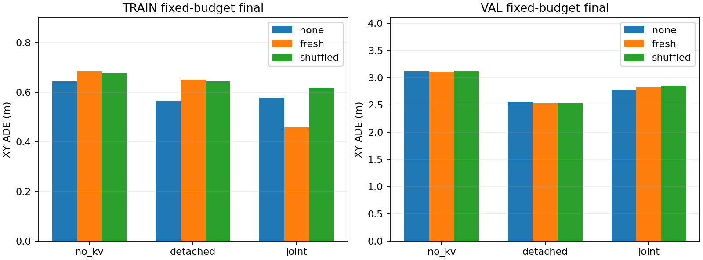
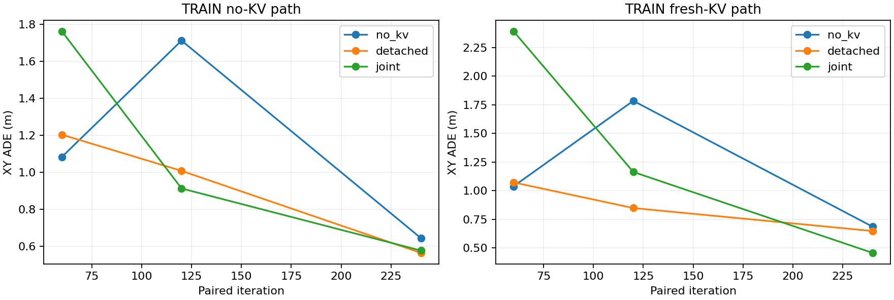
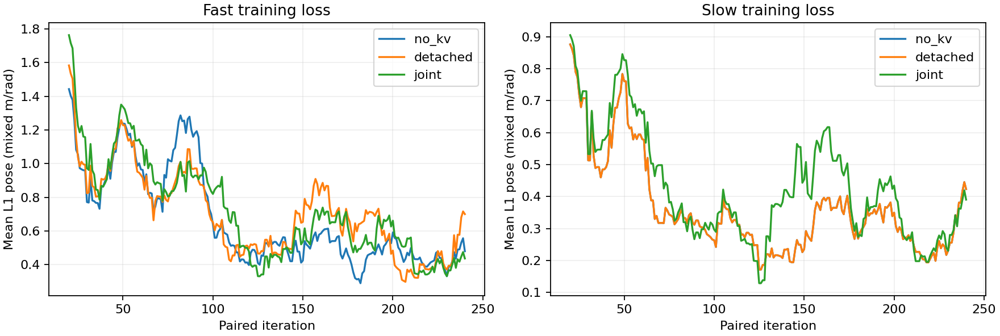

# V1.1 加强 Slow 与持续 live-KV 联合训练

本实验按 [参考代码审计](KV_REFERENCE_TRAINING_AUDIT.md) 的建议，保留原架构，增加 Slow 任务适配和持续的 `Fast loss → Slow KV → Slow LoRA` 训练。它是现有小数据上的受控诊断，不是全量训练、异步系统或闭环成绩。结果与验收证据见下文；完整预注册预算见 [实施计划](superpowers/plans/2026-11-06-live-kv-joint.md)。

**结论：持续联合训练后，Fast在训练集开始利用正确的Slow KV内容；当前VAL没有对应的增量收益。** 这说明训练协议确实影响KV消费，不能将上一轮的弱敏感度当作架构上限；同时不能把训练集收益外推为泛化或闭环改善。

## 为什么增加这轮实验

上一轮只给 Slow 语言 LoRA 40 步、Fast 消费冻结缓存 120 步，尚未持续执行阶段 D。弱缓存敏感度同时可能来自任务表征不足、消费适配不足和直接回归捷径，不能据此判断 KV 的上限。参考实现支持直接拼接的可训练性，但其任务预训练、联合梯度和输入分工与本项目不同，也不能保证拼接后自动获益。

本轮先加强 Slow，再用三个平行组隔离消费端梯度。Fast 和 Slow 获取同一历史图像，Slow 并没有新增传感器信息；它的潜在价值来自更大模型的计算与任务表征。足够好的 Slow 自身轨迹是任务适配的一个检查，仍不足以证明中间 KV 对 Fast 有用。

## 固定协议

数据仍为现有 12 TRAIN /4 VAL 窗口、3 个日志；没有下载新数据。TRAIN 有4个速度≥1m/s的移动窗口和8个低速窗口，VAL只有1个移动窗口。原始1920×1080四帧CAM_F0、2Hz、仅补边、完整2B/0.8B、六层融合和唯一8×3轨迹Head均保持。视觉塔及Merger冻结，语言LoRA和新增模块更新。

初始Fast使用先前80步预热状态，Slow使用先前20步新模块+40步LoRA状态。两者来自已核对SHA的旧诊断检查点，不使用旧Fast最终消费状态。专家轨迹只进入监督；Slow反馈固定为已完成Fast80产生的数值轨迹，并保存教师参数身份。

| 阶段/组 | 新增迭代 | Slow更新 | Fast输入与梯度 |
| --- | ---: | --- | --- |
| 共享Slow加强 | 240 | 自身轨迹loss，开放LoRA及新模块 | Fast不更新 |
| `no_kv` | 240 | 每步自身loss | 始终无KV |
| `detached` | 240 | 每步自身loss | 70%新鲜断梯度KV、30%无KV |
| `joint` | 240 | 每步自身loss，读取时额外接受Fast loss | 70%新鲜live-KV、30%无KV |

三组从完全相同Fast/加强Slow状态开始，优化器重置，目标顺序相同。每组120次移动、120次低速；读取组每个分层各84次新鲜、36次无KV。分层内按洗牌周期无放回；它不是均匀全量数据采样配方。

每个配对步使用一次**更新前**的Slow前向，同时生成自身轨迹和KV。目标为`L_F + L_S`，统一backward完成后才更新两模型。各自AdamW，LoRA LR1e-4、新模块LR5e-4、WD0.01、常数LR；**每个模型分别clip1**，避免Fast梯度大小影响Slow对照。Loss沿用mean L1 pose，混合m/rad；ADE/FDE只计算XY。

共960次新迭代、1680次optimizer.step（Slow960、Fast720）。每组Fast累计80+240=320次；Slow新增模块累计60+240+240=540次、LoRA40+240+240=520次。共享和继承成本单独计数。组间相同更新步数不能等同于相同FLOPs，联合反向及KV读取均有额外开销。

MB1、无梯度累积、seed42，关闭增广/dropout/TF32，开启严格确定性与CUBLAS工作区设置。TRAIN曲线在60/120/240步记录；VAL只在每组完整240步后读取，不选checkpoint、不调参、不延长预算；没有TEST参与。

## 实现与机械检查

- [joint_protocol.py](../slowfast_v11/joint_protocol.py)：严格配置、移动分层、独立缓存模式洗牌、预定梯度探针步57/120/172/240。
- [joint_training.py](../slowfast_v11/joint_training.py)：三组配对更新、独立clip、固定反馈detach和Fast-loss-only梯度探针。
- [train_slowfast_joint.py](../tools/train_slowfast_joint.py)：模型/数据身份、共享Slow阶段、三组训练、固定诊断、两优化器/RNG/采样状态保存。
- [reload_slowfast_joint.py](../tools/reload_slowfast_joint.py)：独立进程重建VAL条件，并实际重放第239→240步；比较两模型参数、两个AdamW状态、RNG和预测。
- [report_slowfast_joint.py](../tools/report_slowfast_joint.py)：生成不包含原始图像和权重的可迁移证据。

探针在总loss反向之前调用`autograd.grad(L_F, ...)`，分别检查六层K/V与十二个K/V LoRA-B参数，避免把Slow自身监督的梯度误认成Fast指导。joint/fresh必须全部有限且非零；两个控制组必须没有该梯度。视觉及Merger必须冻结且无梯度。

在确定性输入和独立clip下，`no_kv`和`detached`的Slow更新应逐位一致。最终权重摘要直接核对；这比仅比较Slow loss更强。joint的Slow参数变化可以说明梯度参与了更新，不能单凭变化声称规划收益。

## 结果与验收

Slow共享加强阶段的TRAIN ADE从**2.4137m降到0.3759m**；随后控制组继续训练后为0.2657m，联合组为0.3267m。Slow显著学到了训练轨迹，但控制/联合Slow的VAL ADE仍为2.9145/3.0042m，不能称为已充分训练的泛化规划器。

下表保留同一组最终权重的三种推理条件。`no_kv`组从未训练外部KV消费，其fresh/shuffled仅作接口诊断，不能当作正式部署方案。

| 训练组 | 推理条件 | TRAIN ADE / FDE (m) | VAL ADE / FDE (m) | VAL heading MAE (rad) |
| --- | --- | ---: | ---: | ---: |
| no_kv | 无KV | 0.6436 / 0.8014 | 3.1275 / 5.3648 | 0.04091 |
| no_kv | 新鲜KV | 0.6861 / 0.9037 | 3.1091 / 6.0360 | 0.05197 |
| no_kv | 错配KV | 0.6766 / 0.9150 | 3.1176 / 6.0420 | 0.05130 |
| detached | 无KV | 0.5636 / 0.5422 | 2.5498 / 5.2223 | 0.26755 |
| detached | 新鲜KV | 0.6487 / 0.5365 | 2.5370 / 5.1357 | 0.28216 |
| detached | 错配KV | 0.6436 / 0.5739 | 2.5320 / 5.1375 | 0.28285 |
| joint | 无KV | 0.5763 / 0.7018 | 2.7818 / 5.0318 | 0.08198 |
| joint | 新鲜KV | **0.4577 / 0.6994** | 2.8310 / 5.0494 | 0.08144 |
| joint | 错配KV | 0.6155 / 1.0740 | 2.8453 / 5.0444 | 0.07983 |

联合组TRAIN打开正确KV，ADE比自身无KV路径降低**0.1185m（20.6%）**；错配KV则比正确KV差0.1577m。移动子集的ADE为无KV1.4047m、正确KV0.9684m、错配KV1.4185m，改善并非只来自静止样本。交换KV后平均轨迹XY变化为0.2310m，高于detached的0.0294m。这些共同支持当前TRAIN上的内容依赖，不能单凭其中一个指标宣称因果或泛化上限。

改善并不均匀：只有4/12个TRAIN窗口的ADE改善，其中3个为移动窗口；低速子集平均ADE从0.1621m升到0.2024m。整体FDE从0.7018m到0.6994m，几乎没有改善。四个VAL窗口的ADE则全部变差。因此结论是**特定TRAIN场景的内容使用开始出现**，不能概括为全场景规划质量提升。

联合组的TRAIN新鲜KV曲线为60步2.3917m、120步1.1641m、240步0.4577m；前两个检查点仍差于同权重的无KV路径，最后才反转。**早期缺少收益不等于最终没有消费能力，梯度存在也不等于已经适配完成。** 当前曲线仍有波动，未验证充分收敛。

VAL上joint打开KV反而使ADE从2.7818m升到2.8310m；错配为2.8453m，内容交换导致的XY变化只有0.0357m。detached的新鲜KV VAL ADE为2.5370m，低于joint，但其heading MAE更高。不能只用独立训练组的VAL终点排名，就把差异归因为推理时正确KV内容；也没有证据宣布联合训练全面胜出。

恒速度参考为TRAIN ADE/FDE0.5973/1.6802m、VAL0.3503/0.6344m。联合组在TRAIN部分位置指标超过CV，但所有学习组的VAL仍明显落后于CV。VAL只有1个移动窗口，其速度约15.08m/s，而TRAIN最高约8.97m/s；这是小样本分布差异的提醒，不能作为事后调整VAL或消除失败结果的理由。







四个预定live-KV探针全部通过：每次Fast-loss-only梯度都到达六层K/V与十二个对应LoRA-B参数；两个控制组无该梯度。no_kv与detached最终Slow权重逐位相同，joint不同。视觉塔与Merger全程冻结。训练在单张H800完成，用时1709.4s，峰值allocated**51.00GiB**、reserved53.30GiB；用时包含数据处理、评测与保存，不能当作纯训练吞吐。

回归测试**567 passed**。独立进程重建三组共39个VAL条件，全部预测最大差异为**0**；实际重放joint第239→240步后，两模型的419个适配器及新增模块参数张量、两个AdamW的1254个状态张量、RNG和预测均精确一致；冻结基座资产另以SHA核验。这里只验证了同GPU/依赖下的一步真实续跑，不声称已有通用多卡完整训练resume入口。结果JSON保留原始`resume_verified:false`作为训练进程结束时状态，独立验收以[reload.json](../evidence/slowfast_v11_joint/reload.json)为准。

结果保存在[evidence/slowfast_v11_joint/](../evidence/slowfast_v11_joint/)：包含完整配对指标、移动分层、逐条件预测、loss/梯度记录、重载与实际断点重放结果。新鲜KV是零观测年龄的离线条件，不是异步部署成绩。旧观测KV仅作最终描述性检查，本轮不训练陈旧消费策略。

后续优先在更多移动日志上充分建立Fast/Slow任务能力，并保留持续联合阶段及错配对照；再判断增益能否迁移到真实年龄条件。当前不宜跳到Future检验、刷新调度或闭环有效性的结论，也没有必要因小样本VAL失败立刻改拼接架构。

## 复现与迁移边界

```bash
export FLA_TILELANG=1
export CUBLAS_WORKSPACE_CONFIG=:4096:8
export CUDA_HOME=/path/to/matching/cuda-toolkit
export PATH="$CUDA_HOME/bin:$PATH"

python -m tools.train_slowfast_joint \
  --train-manifest /path/to/train.jsonl --val-manifest /path/to/val.jsonl \
  --stats /path/to/stats.json \
  --sensor-root /path/to/sensors/openscene-v1.1/sensor_blobs/mini \
  --fast-model /path/to/Qwen3.5-0.8B --slow-model /path/to/Qwen3.5-2B \
  --initial-checkpoint /path/to/previous_diagnostic/final.pt \
  --output outputs/slowfast_v11_joint/run_new

python -m tools.reload_slowfast_joint \
  --run outputs/slowfast_v11_joint/run_new \
  --output outputs/slowfast_v11_joint/run_new/reload

python -m tools.report_slowfast_joint \
  --run outputs/slowfast_v11_joint/run_new \
  --test-xml /path/to/tests.xml \
  --output evidence/slowfast_v11_joint
```

配置为[slowfast_v11_joint.yaml](../configs/slowfast_v11_joint.yaml)。旧诊断final.pt及其result.json、模型资产和原始数据需要在本地；不会把本轮过拟合权重作为正式训练初始化。构造器的可选配置/采样注入保留旧验证入口的默认行为。

此入口刻意限制12/4窗口、单张H800和固定预算，**不能换成全量manifest后直接当正式快慢训练器**。全量阶段应使用官方navtrain筛选、日志分组TRAIN/VAL和完整TRAIN统计，重新确定epoch/LR计划、分布式采样及恢复。当前固定Fast80反馈较弱且不会随模型改善而刷新；正式训练需要单独设计反馈更新、缺失反馈和真实失配分布，保留模型版本身份。

断点一致性仅针对当前无dropout、无增广和同GPU/依赖的配置；不外推为不同GPU、CUDA或FLA后端间逐位一致。

本轮Slow只接受轨迹监督，未实现V1.1的高层运动类别Head或Future Head；也不包含真实交付年龄训练、多GPU传输、在线刷新、门控或闭环。陈旧VAL只有1个静止窗口，无法证明移动场景容忍延迟；4个VAL也无法确定性能上限。即使训练集得到KV收益，仍须用更多移动日志、多个种子、实际交付时序及闭环验证。
