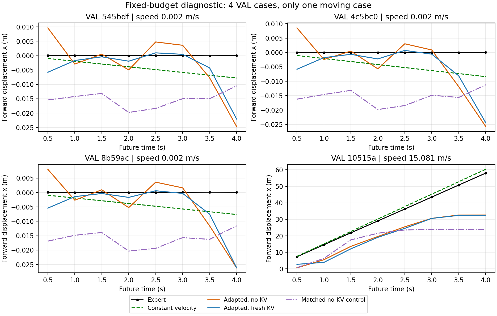
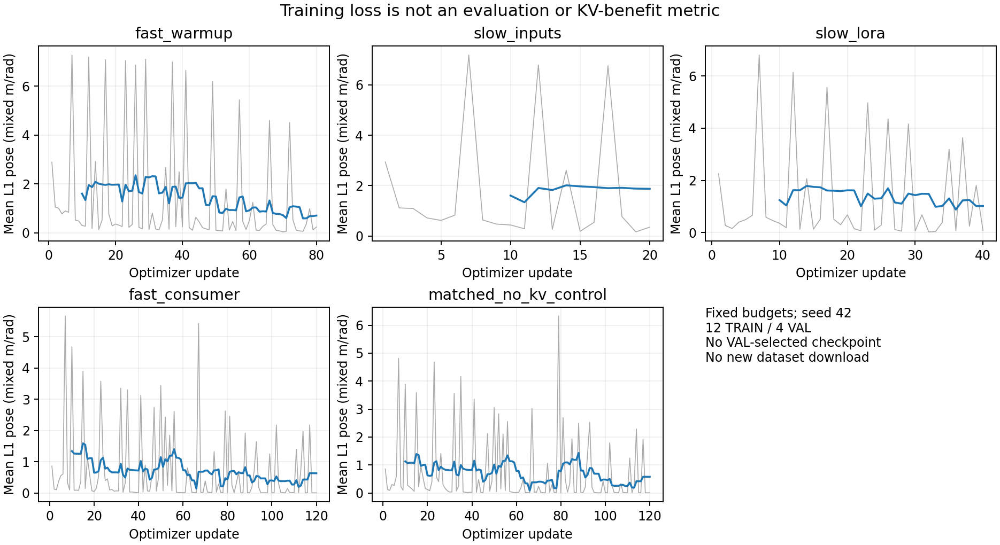

# V1.1 小规模适配与 KV 配对验证

本轮完成了真实权重训练、同检查点 KV 对照、独立进程重载，以及等 Fast 更新步数的无 KV 对照。**当前结果尚不支持 KV 改善位置规划；模型能训练和恢复，不等于快慢协作已有效。** 这是一轮固定小预算诊断，不是完整 NAVSIM 训练或闭环验证。

## 预先固定的实验

仅使用现有 12 TRAIN / 4 VAL 窗口、3 个独立日志，不下载任何数据。TRAIN 有 4 个速度 ≥1m/s 的移动窗口；VAL 只有 1 个，其余 3 个为静止/低速。没有访问 TEST，也没有用 VAL 选择 checkpoint、训练步数或超参数。

保留原生完整 0.8B / 2B、四张 2Hz CAM_F0、原始 1920×1080 图像（仅补边到 1920×1088）、官方 Ego/command 和未来 4 秒 8×3 轨迹。Loss 仍为官方 mean L1 pose，不能把这个混合 m/rad 的 loss 标作米。下文 ADE/FDE 只计算 XY，heading 单独计算。

| 阶段 | 更新步数 | 训练内容 |
| --- | ---: | --- |
| Fast 预热 | 80 | 无 KV，训练现有 LoRA、输入模块、Queries 和 Head |
| Slow 输入预热 | 20 | 冻结语言主干，保留穿过主干的梯度，训练新增模块 |
| Slow 适配 | 40 | 开放语言 LoRA；视觉及 Merger 继续冻结 |
| Fast 消费 KV | 120 | 冻结 Slow；36 次无 KV、48 次新鲜 KV、36 次真实旧观测 KV |
| 独立等步数对照 | 120 | 从相同 Fast 预热权重恢复，按完全相同 TRAIN 目标顺序训练，始终无 KV |

主实验共 260 次更新；对照另加 120 次。两条 Fast 路径各有 200 次更新（共享 80 次预热），但主实验额外训练 Slow 60 次，**总训练计算量不相等**，也尚未完成同等辅助监督 A1 消融。

MB1、训练 seed42、无增广、LoRA dropout0，AdamW：LoRA LR1e-4、新模块 LR5e-4、weight decay0.01、clip1。本轮使用常数 LR，不能代替正式 8,000 步配置。Split 直接沿用已有 manifest，其身份由 SHA256 固定；seed42 用于训练采样，不重新划分日志。

Slow 的轨迹反馈全部由完成 80 步预热的 Fast 在对应源观测上产生，随后固定版本；没有用专家轨迹代替反馈。Slow 训练完成后导出 detached CPU 快照，Fast 消费阶段不更新 Slow。该版本和数据/模型/图像身份均写入 checkpoint。

## 陈旧和错配缓存如何产生

陈旧源输入使用真实过去四帧、过去 Ego/command 和原始位姿。年龄取真实时间戳差；相对位姿为 `P_current^-1 P_source`。模型输入不读取未来 GT；后者只进入 loss 和指标。

| 源观测年龄 | TRAIN 可用窗口 | VAL 可用窗口 |
| --- | ---: | ---: |
| 0s | 12 | 4 |
| 0.5s | 5 | 1 |
| 1.0s | 2 | 0 |
| 1.5s | 1 | 0 |

排除均来自缺少历史图像，没有补帧或用新缓存顶替。1s / 1.5s 的 TRAIN 子集都是静止场景；唯一的 0.5s VAL 窗口也是静止场景。因此其毫米/厘米级误差不能证明移动场景能耐受旧缓存。

新鲜 KV 是零观测年龄的离线条件，不是零延迟可部署结果。旧 KV 的图像/位姿确实来自更早观测，但本轮没有模拟实际交付时间、刷新或通信，不能替代“真实异步交付年龄”实验。

错配对照交换完整 donor KV、位置和 valid mask，保留当前输入及目标 metadata。TRAIN 全部取另一个日志的 donor；VAL 只有一个日志，采用至少相隔 2 秒的其他样本。这个条件是刻意违反内容匹配的离线诊断，不能通过在线 admission。

## 同一最终检查点的结果

| 条件 | TRAIN ADE / FDE (m) | VAL ADE / FDE (m) |
| --- | ---: | ---: |
| 无 KV | 0.9131 / 1.9345 | 3.1553 / 6.3671 |
| 新鲜 KV | 0.9478 / 2.0583 | 3.2426 / 6.4330 |
| 错配 KV | 0.9461 / 2.0361 | 3.2481 / 6.4365 |

新鲜 KV 的 VAL ADE 比无 KV 高 0.0873m。航向 MAE 则从 0.07145rad 降到 0.06092rad，属于指标取舍，不能只选其中一项宣称全面提升。

等 Fast 更新预算的独立无 KV 对照，TRAIN ADE/FDE 为 **1.3652/3.6475m**，VAL 为 **3.7618/8.5193m**。初始化参数身份、重置优化器和 120 个 TRAIN 目标的顺序均与 KV 消费阶段核对一致。因此，KV 训练路径的位置误差低于这个对照，但它关闭 KV 后更好：收益可能来自训练条件/优化差异，而不能归因为推理时正确 Slow 内容的增量价值。对照的 VAL heading MAE 为 0.03629rad，优于主模型两条路径；同样需要保留指标取舍。

交换 KV 内容后，平均轨迹 XY 变化仅为 TRAIN 0.01357m、VAL 0.01135m；新鲜/错配 KV 的 VAL ADE 也只差 0.00549m。**当前检查点对正确 KV 场景内容的依赖较弱，尚未获得稳定的位置规划增量价值。** 这是输出敏感度证据，不是 Attention 权重或因果贡献的直接测量。

适配前，直接读取未适配 KV 令 VAL ADE 从 5.9124m 变为 7.2392m；适配后这种差距明显缩小。Fast 的 TRAIN 误差也下降，但不能把更多训练带来的下降全部归因于 KV。

各陈旧子集必须与同一批 target 的无 KV、新鲜 KV 比较。完整的配对数值、逐时距和移动/低速分层指标见 `evidence/slowfast_v11_validation/`。VAL 的唯一旧缓存样本没有实际运动，不能据此得出 H1 的时效性结论。

本轮恒速度参考 ADE 为 TRAIN 0.5973m、VAL 0.3503m，明显优于这些学习模型的总体 ADE。这说明当前小预算模型仍未形成充分训练的规划基线；本轮结果不能否定充分训练后 KV 的潜力，也不足以支持增加 Future/刷新机制的收益主张。

下一阶段优先建立充分训练的 Fast-only 和 Slow 辅助规划，再检验同一检查点的新鲜 KV 是否稳定优于无 KV，并确认错配内容会产生有意义的退化。当前仍缺同等辅助监督、多个种子、足够多移动场景及实际交付年龄实验。

## 重载、对照与证据口径

独立进程重新构造两份原生模型，加载最终 Fast/Slow 参数、固定反馈与原始数据，重新生成缓存。全部 13 个 VAL 条件（4 无 KV、4 新鲜、4 错配、1 陈旧）的预测最大差异为 **0**。

保存了优化器、RNG 和采样进度，但尚未执行真实中途断点继续训练比较，因此不声称本轮验证了逐位一致的训练续跑。此次恢复验收针对最终预测重载。

最终回归 **495 passed**（原有 419 项 + 本轮 76 项）；独立复核覆盖数据、阶段训练、重载及等步数对照。真实执行证据和不含机器绝对路径的结果见 [verification.json](../evidence/slowfast_v11_validation/verification.json)、[main_result.json](../evidence/slowfast_v11_validation/main_result.json)、[control_result.json](../evidence/slowfast_v11_validation/control_result.json)、[reload.json](../evidence/slowfast_v11_validation/reload.json)。

主实验在单张 H800 上分阶段执行，峰值 allocated31.75GiB / reserved36.74GiB。它使用冻结 Slow 离线缓存，并非 P0 那次保留 Fast→Slow 联合梯度的 D 阶段；两者显存不能直接互换。多 GPU、Future Head、在线调度、闭环成绩均未验证。

下图展示全部 4 个 VAL 样本的前向位移；只有一个移动样本，模型误差不能按四条独立路线解释。



训练 loss 曲线只用于检查优化过程，不是 KV 有效性的评价：



## 使用代码与复现

- `slowfast_v11/diagnostic_data.py`：当前/历史观测、真实年龄配对、缺失原因和 split 内错配。
- `slowfast_v11/validation.py`：阶段 trainability、优化器、固定采样、完整参数身份与配对指标。
- `tools/validate_slowfast_v11.py`：260 步主实验；仅 TRAIN 反向，最终固定预算评测。
- `tools/reload_slowfast_validation.py`：独立重建全部 VAL 条件，检查模型、数据、反馈和参数身份；默认要求精确一致。
- `tools/control_slowfast_v11.py`：恢复预热 Fast，重置 AdamW，复用相同 120 个 TRAIN 目标顺序执行无 KV 对照。

环境沿用 [P0 说明](SLOWFAST_V11_P0.md)。权重与原始数据、CPU 缓存、训练 checkpoint 不提交 Git。默认相对路径可通过 CLI 更换，数据准备与完整训练工程仍按原迁移指南处理。

```bash
export FLA_TILELANG=1
export CUBLAS_WORKSPACE_CONFIG=:4096:8
export CUDA_HOME=/path/to/matching/cuda-toolkit
export PATH="$CUDA_HOME/bin:$PATH"

python -m tools.validate_slowfast_v11 \
  --train-manifest /path/to/train.jsonl --val-manifest /path/to/val.jsonl \
  --stats /path/to/stats.json \
  --sensor-root /path/to/sensors/openscene-v1.1/sensor_blobs/mini \
  --fast-model /path/to/Qwen3.5-0.8B --slow-model /path/to/Qwen3.5-2B \
  --output outputs/slowfast_v11_validation/run_new

python -m tools.reload_slowfast_validation \
  --checkpoint outputs/slowfast_v11_validation/run_new/final.pt \
  --output outputs/slowfast_v11_validation/reload_new.json

python -m tools.control_slowfast_v11 \
  --checkpoint outputs/slowfast_v11_validation/run_new/final.pt \
  --output outputs/slowfast_v11_validation/control_new
```

输出路径已有结果时拒绝覆盖。此入口限制 12/4 窗口和固定步数，不是全量训练入口。阶段/预算/优化器固定在 `configs/slowfast_v11_validation.yaml`；修改研究协议应建立新配置与新运行，而不是沿用本轮结论。
